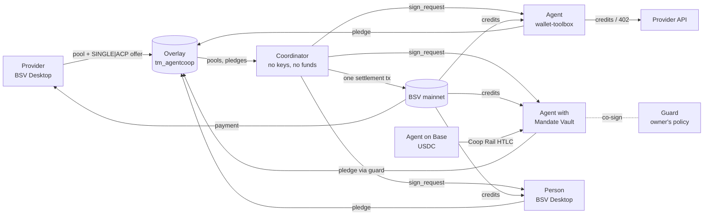

# AgentCoop

**x402 taught agents how to pay. AgentCoop lets many agents buy one block of capacity together, with no deposits, no escrow and no refunds: one atomic BSV transaction pays the provider and delivers every share.**

BSV Blockchain track, "DeFi Rails for Agentic Payments" · TUM Blockchain & AI Hackathon, 30–31 October 2026

> Status (31 Oct): the core flows run **on mainnet**: settlements through the coordinator, a vault agent, a Lighthouse settlement, redeems, 402 payments and the Mandate Vault (see [Example transactions](#example-transactions)). Every flow also runs end to end on the wallet-toolbox **mock chain** with the real components (`npm test`, run by CI on every push). Security: [docs/AUDIT-READINESS.md](docs/AUDIT-READINESS.md).

## What it does

AI agents buy paid APIs, LLM tokens and GPU time one call at a time, at list price. The real discounts (reserved GPU blocks, provisioned throughput, plan tiers) sit behind large upfront commitments that small teams cannot make. Group buying would fix that, but today it always means putting everyone's money with an intermediary.

AgentCoop is a **non-custodial group-buying layer** on BSV. A provider announces a pool ("1,000 GPU-hours for 25,000 sats") and pre-signs its credits as an open offer. Agents (and people) pledge from their own wallets; until the pool fills, every satoshi stays in its owner's wallet. When it fills, a coordinator assembles **one atomic transaction** that pays the provider and delivers BSV-21 credit tokens to every participant (delivery versus payment). Each participant checks the whole transaction and signs only its own input. The coordinator holds no keys and no money, and anyone can run one.

Credits are spent on the provider's API over HTTP 402 or resold to other agents on an atomic market. An agent's budget can live in an owner-controlled **Mandate Vault** (agent + guard 2-of-2, owner can always withdraw alone), so a prompt-injected agent cannot spend outside its owner's policy. Agents holding USDC on Base can join through **Coop Rail**, an HTLC swap into BSV (offline proof of concept).



## Usage & value note

**Problem.** AI agents buy compute, model capacity and data one call at a time. The packages with real discounts (reserved GPU blocks, provisioned throughput, enterprise data plans) require large upfront commitments small teams cannot make, and pooling today means trusting an intermediary with everyone's money.

**What AgentCoop is.** A non-custodial group-buying layer on BSV. Providers publish a pool and pre-sign their credits as an open offer. Agents pledge from their own wallets; when the pool fills, a single atomic transaction pays the provider and delivers BSV-21 credits to every participant. No deposits, no escrow, no refunds. Credits are spent on the provider's API over HTTP 402 or resold on an atomic secondary market. Agent budgets live in owner-controlled Mandate Vaults, and agents holding USDC on Base can join via an atomic swap.

**What we prove on chain.** N independent parties, one transaction, zero satoshis held by any intermediary at any point, and delivery versus payment in the same transaction. On the mock chain: 100 participants in one 36.5 kB settlement for 3,670 sat, and 50 participants of which 10 pledge from Mandate Vaults through the guard (19.75 kB, 1,986 sat); `custodiedSats` is computed from the chain, not assumed. Demo pricing is illustrative; the mechanism is real.

**Target users.** Small AI teams and agent operators (buyers); AI infra resellers, LLM routers, GPU and data providers (sellers, who get pre-paid, all-or-nothing demand before they buy capacity); liquidity providers (underwriters).

**How people use it.** A provider opens a pool from BSV Desktop with `provider-cli`. An agent owner funds a Mandate Vault and sets a policy with `owner-cli`. Agents find pools on the overlay, decide with their forecast, pledge, sign the settlement and spend credits over 402. People join from the web app with BSV Desktop.

**Value for BSV.** New users and liquidity from other chains (x402 agents on Base), recurring multi-party settlement transactions, tradable BSV-21 credit markets, and per-call micropayment volume. All of it is practical only because BSV makes multi-party atomic transactions and cent-sized payments cheap.

## How it meets the track requirements

| Requirement (TBC26 §3) | How | Where |
|---|---|---|
| BSV TypeScript SDK + Wallet Toolbox | Every transaction is built with `@bsv/sdk` 3.2.1; agents, provider API, guard, coordinator tests and maker use `@bsv/wallet-toolbox` 2.14.9 | `packages/core`, `apps/*` |
| User-facing flows on BSV Desktop / Browser | Provider (open pool, mint), owner (vault, policy, withdraw), people (pledge) use `WalletClient('auto')` | `apps/provider-cli`, `apps/owner-cli`, `apps/participant-cli`, `apps/web` |
| Real transactions (mainnet) | Pool, pledge, settlement, redeem, 402, vault, Lighthouse: see the table below (the market sweep and Coop Rail are still mock-chain only) | [Example transactions](#example-transactions) |
| Non-custodial wherever funds are involved | One atomic DvP transaction; the coordinator holds nothing; vault funds need agent + guard and the owner can always exit | [docs/THREAT-MODEL.md](docs/THREAT-MODEL.md) |
| At least one AI agent that pays | Three agents forecast demand, pledge, sign the settlement, redeem credits and pay retail over 402; an LLM brain is optional | `apps/agents` |

## Quick start (mock chain: no wallet, no satoshis)

Node 22 or newer. Every command below was run on a fresh container on 30 Oct.

```bash
npx npm@11 install        # npm 10.9 cannot install this workspace; npm 11 can
```

```bash
npm test                  # 55 files: protocol, overlay, coordinator, agents, guard, rail, web
```

```bash
npm run demo              # the whole flow in one command (= demo:k1): provider opens a pool, 3 agents forecast,
                          # decide, pledge and settle it in ONE transaction, spend the credits, then trade surplus on the market
```

```bash
npm run demo:failed-pool  # an unfilled pool costs nothing but the registration fee; the agent withdraws and joins a right-sized pool
```

```bash
npm run demo:injection    # a prompt-injected vault agent: its own policy vetoes the pledge; with that bypassed, the guard refuses
```

```bash
npm run demo-injection -w @agentcoop/scripts   # the guard's side of the same attack: "100% of the budget into pool X" is refused
```

```bash
npm run infra             # overlay :8080 + coordinator :8090 (WS /ws), persistent data/
```

```bash
npm run web:mock          # the web app with a scripted mock Desktop
```

## Mainnet run

Done so far on mainnet: the provider's BSV Desktop mint and pools (T1, T2), agent and human pledges (T3, T4), settlements through the coordinator (T5), a vault agent's settlement (T5v), a Lighthouse settlement (T5-L), redeems (T6), agent 402 payments (T7) and the Mandate Vault (T9, T10); see [Example transactions](#example-transactions). The steps, each first with ≤ 1,000 sat:

1. Server wallet keys: `npx tsx scripts/keygen.ts --only-missing >> .env` (keys stay in `.env`, which is git-ignored).
2. Fund them from the treasury BSV Desktop: `npm run fund -w @agentcoop/scripts -- agent-1=1000 --dry-run`, then without `--dry-run`.
3. `npm run infra`, `npm run provider`, `npm run guard -w @agentcoop/guard`.
4. Provider: `npm run provider-cli -- mint …` and `open-pool` from BSV Desktop. A running provider API picks up the minted token id from `products/*.json` within 5 s, no restart.
5. Agents: `npm run agents`. Owner: `npm run owner -w @agentcoop/owner-cli -- create-vault | policy | fund | withdraw`.
6. Coop Rail (Base Sepolia → BSV, ≤ 1 USDC / ≤ 1,000 sat): `npm run deploy -w @agentcoop/maker -- --yes`, then `npm run swap-demo -w @agentcoop/maker -- --vault <vaultId>` (dry run: checks keys, balances, guard and vault), then the same with `--yes`. See [docs/RAIL-POC.md](docs/RAIL-POC.md).

Operations guide: [docs/OPS.md](docs/OPS.md). Public deployment of the overlay and coordinator: [infra/README.md](infra/README.md).

## Example transactions

| # | Transaction | Signed by | What you see on chain | Mainnet txid | Mock-chain test |
|---|---|---|---|---|---|
| T1 | Credit token deploy | Provider (BSV Desktop) | BSV-21 deploy+mint (also on BananaBlocks) | [762e6b0837…](https://whatsonchain.com/tx/762e6b083728f9cd653b938e2947a92e50d0a92218351b1c64b0fe1e696e089f), [0ae50b8b69…](https://whatsonchain.com/tx/0ae50b8b69efd9d1b0dacc7cefaf8e4abaea9cd33f5e4e7c93af4d73d715437d) (BSV Desktop) | `test/skeleton.mockchain.test.ts` |
| T2 | Pool announcement, credits reserved | Provider | N-credit UTXO + `OP_RETURN agentcoop pool` | [9118788a77…](https://whatsonchain.com/tx/9118788a77efb3854878d47c1edb199d03ecbf00ab8e3da32b0a907c8f18c77c), [53a240f5c4…](https://whatsonchain.com/tx/53a240f5c44123211c3befa737f7ce1cae356c15bd72256279e47f5e43d93ca6) (BSV Desktop; offer [e48140bf07…](https://whatsonchain.com/tx/e48140bf079c25af91eda8060d25dc046dd7c6e50f66de37f95ec2a98e5134b2)) | `test/skeleton.mockchain.test.ts` |
| T3 | Pledge | Agent / person | Pledge coin, registration fee to the provider, `OP_RETURN agentcoop pledge` | [00f50d70bd…](https://whatsonchain.com/tx/00f50d70bd5aa27c5e5333c92462ba9997cb57037ef9101df2c9ec4a0f423aef), [00d78d5789…](https://whatsonchain.com/tx/00d78d5789320dfc120b2e5361bb7d709a0d2eacee1b37c0497f08d5c82cde7a), [95bd801816…](https://whatsonchain.com/tx/95bd801816fc20821be4af863e63b21a4c532acc1113d756fa1d5f6786f41410), [0a4c5fa4ef…](https://whatsonchain.com/tx/0a4c5fa4efe7fcac15205dc0c46a6239e4b48af6a0f2fcac8a9e6e846ddd88f6), [67e3b14b4b…](https://whatsonchain.com/tx/67e3b14b4beb90a94d2fc63677241e211a45eab7cfb45a28094340b7f7173926) (agents + a person from BSV Desktop) | `test/skeleton.mockchain.test.ts` |
| T4 | Pledge cancel | Pledge owner | The coin spent back to its owner | [8849f78d78…](https://whatsonchain.com/tx/8849f78d78d874b61501c0b00ad85154d6e306ad77135808bcf75f42e03777a2) (an agent left out of a settled pool takes its coin back) | `test/skeleton.mockchain.test.ts` |
| **T5** | **Settlement (DvP)** | Provider SINGLE\|ACP, everyone ALL | **N inputs; provider paid and every participant's credits in one tx; pledge-list hash** | [6d320c9af8…](https://whatsonchain.com/tx/6d320c9af886bd2514da2c4af0ed0c64477840e08564fb8b8e381270aa5b2763), **[5314ab8b9f…](https://whatsonchain.com/tx/5314ab8b9fc731c824fd49a0bbb6a69bb0f57ad2fff11dda656d40eb6584a185)** (the coordinator's signing round: 2 agents + 1 person, audit `consistent`, `custodiedSats: 0`), [9c69891979…](https://whatsonchain.com/tx/9c6989197958fe637737c5b0708b5a7cc6bb711dabd1d00ddaeca51eb96119d1) | `apps/coordinator/test/e2e.integration.mockchain.test.ts` |
| T6 | Credit redeem and return | Agent / provider | BSV-21 transfer to the provider, and back | [958e646fde…](https://whatsonchain.com/tx/958e646fde935c5548f4fe537e4c68871524fe1506e54b8aa8156de700321051), [5354a7a58c…](https://whatsonchain.com/tx/5354a7a58c28ba85fe735e93588a94e1673c2f9e3aa45856116bf929e497f4eb), [937ff13b55…](https://whatsonchain.com/tx/937ff13b553deb23e68e41ee8d18d19ba40ceeebc826d6432d39a95846517409) (redeem) | `test/provider.credits.mockchain.test.ts` |
| T7 | Retail 402 payment | Agent (AuthFetch) | BRC-29 payment to the provider | [5176e9eeb8…](https://whatsonchain.com/tx/5176e9eeb8604d83ba6154f10ddaf8e8dee66ad185338b0127f2fbf2efcf853f), [bee39537a1…](https://whatsonchain.com/tx/bee39537a16f75bb1ced8ea8dd8ad71e95610ef7f8c91d187267b3c271d94bb8) (agents, HTTP 402) | `test/provider.402.mockchain.test.ts` |
| T5v | Settlement with vault-locked credits | Agent + guard 2-of-2 | A vault agent's credits land on its vault script, not a P2PKH | [08a6455612…](https://whatsonchain.com/tx/08a6455612925df713c4738b450d3018ee689ad9fcb064dbfb3555603ba47db5) (a vault agent: guard approved the pledge and co-signed; its credits sit on the vault script) | `test/e2e.vault-credits.mockchain.test.ts` |
| T5-L | Settlement with offline (Lighthouse) pledges | Human SINGLE\|ACP once, guard ALL | Exact lighthouse coins, no change; humans offline during the round | [83d339b896…](https://whatsonchain.com/tx/83d339b8963c0f12cc038fc65e751be077386bee3ea045f5cc526e2cb9cd585c) (a person signed once from BSV Desktop and went offline; the guard co-signed the round) | `test/e2e.lighthouse.mockchain.test.ts` |
| T8 | Market sweep | Sellers SINGLE\|ACP, buyer ALL | Several sellers paid, buyer gets credits | pending | `test/market.mockchain.test.ts` |
| T9 | Vault funding and owner withdrawal | Owner (BSV Desktop) | Vault script output; spend through the `OP_IF` branch | [5b5e452c3b…](https://whatsonchain.com/tx/5b5e452c3b0c5c0e1fe0f093dcc36a5f357f71a9f96ff2d12c3a21db5e4eefd8) (funding) | `test/vault.mockchain.test.ts` |
| T10 | Guard-approved payment | Agent + guard 2-of-2 | Spend through the multisig branch | [2e7912d41d…](https://whatsonchain.com/tx/2e7912d41d9bef542539469f0c0742af4e6bacc9c2d0c566f66ef6a36ee82475) (pledge from the vault), [4390605025…](https://whatsonchain.com/tx/4390605025d780616cd11389b5b4941d948bace923aa3821d8b7ab5a6b9af51b) (vault-locked credits redeemed, agent + guard) | `test/vault.mockchain.test.ts` |
| T11 | Coop Rail, BSV side | Maker funding; agent + guard claim | Hash-locked output; the claim reveals the preimage | pending | `test/e2e.rail.mockchain.test.ts` |
| T11b | Coop Rail, Base side | Agent lock, maker claim | HTLC contract on BaseScan | pending (Base Sepolia) | `apps/maker/test/htlc.evm.test.ts` |

## Non-custodial design and threat model

Nobody holds anybody's money at any point: until settlement a pledge coin is in its owner's wallet, and the settlement both pays and delivers. The coordinator has no keys. Participants and the guard verify the credit lineage themselves instead of trusting the overlay. What is not closed is stated as such:

- **Detectable, not prevented:** a coordinator's choice of whom to include (deterministic order, pledge-list hash on chain, an audit endpoint, and any coordinator can close any pool).
- **Open, bounded:** a provider that takes payment but does not serve (credits are resellable), a redeemed balance held off chain (≤ 20 credits), a compromised agent and guard together (bounded by the vault balance), BRC-100 hash signing (one active pledge).
- **Closed while the credits sit on the vault:** an agent selling its credits to escape the guard. Vault pledges can lock their credits to the vault; the guard lets them go only to an allowed provider or back into the vault, and listings pay the vault at or above the owner's floor.
- **Open, found in our own review (F-10):** a provider's credit return of an agent's whole prepaid balance sends vault-redeemed credits to the agent's own key instead of the vault, so they leave the guard one step later. Reproduced by a test; the fix is in the provider API ([docs/AUDIT-READINESS.md](docs/AUDIT-READINESS.md) §6).
- **Open:** no reverse direction for Coop Rail.

Every threat, its control, and the test that exercises it: [docs/THREAT-MODEL.md](docs/THREAT-MODEL.md).

## Security and audit

- [docs/AUDIT-READINESS.md](docs/AUDIT-READINESS.md): what an auditor needs on day one. Value at risk, trust boundaries, scope by priority with paths and sizes, 16 invariants each tied to its code and test, our own findings (F-1 to F-11), dependency and secret scans, mainnet evidence.
- [docs/THREAT-MODEL.md](docs/THREAT-MODEL.md): 23 threats, each with its control, code, test and mainnet transaction.
- [SECURITY.md](SECURITY.md): how to report a vulnerability.
- [docs/ROADMAP.md](docs/ROADMAP.md): what has to happen before real budgets, and how we would use an audit.
- `npm run check:docs` fails if any file or test cited in these documents does not exist. CI ([.github/workflows/ci.yml](.github/workflows/ci.yml)) runs it with the typecheck and the full test suite on every push, without repository secrets.

## What is real and what is simulated

| Real | Simulated |
|---|---|
| Every payment, pledge, settlement, credit token, market listing, vault and HTLC is a real BSV transaction built with the SDK (on the mock chain until the mainnet run) | The GPU jobs and the proxy bandwidth: the provider API runs a simulator per product (queue, log, reproducible result hash) |
| Signatures, sighash scopes, lineage checks, overlay admission rules, the guard's policy checks | Prices are illustrative ("demo pricing") |
| The Base HTLC contract (compiled with solc 0.8.37, run in an in-memory EVM in tests) | The Base side is not deployed yet (Base Sepolia pending) |

## Components

| Component | Track | What it is | README |
|---|---|---|---|
| `packages/core` | A | Protocol core: one atomic DvP settlement per pool (provider SINGLE\|ACP offer, participants ALL), `verifySettlementPlan` that every participant and the guard run, overlay-free `verifyLineage`, signed listings and one-tx sweeps, vault-locked credits, guard-backed Lighthouse pledges for offline humans | [README](packages/core/README.md) |
| `packages/overlay` | B | `tm_agentcoop` / `ls_agentcoop`: BSV-21 rules + pool, pledge, settlement, vault, offer records | [README](packages/overlay/README.md) |
| `apps/coordinator` | B | Signing rounds over WebSocket, side API, audit and custody metrics | [README](apps/coordinator/README.md) |
| `apps/provider-api`, `apps/provider-cli` | C | A simulated provider selling two products: H100 GPU-hours and residential-proxy GB. Each job is paid in one of two ways: at retail through HTTP 402 (BRC-105), or free from credits redeemed from the pool (the lineage is checked, at most 20 credits prepaid, and only the sender can claim a transfer). The operator's BSV Desktop CLI mints the credit token, opens pools (an offer signed SINGLE\|ACP, also published on chain), cancels them and sweeps pool revenue | [api](apps/provider-api/README.md), [cli](apps/provider-cli/README.md) |
| `apps/agents`, `apps/participant-cli` | C | Agents whose own job is GPU work. Each forecasts its week, decides on pools with a rules or LLM brain behind a policy enforced in code, pledges (optionally from a Mandate Vault, with the guard co-signing), checks and signs the settlement, then spends, lists or buys credits. A live SSE feed serves the web app. A human joins the same pools from BSV Desktop with the participant CLI | [agents](apps/agents/README.md), [cli](apps/participant-cli/README.md) |
| `apps/guard`, `apps/owner-cli` | D | Mandate Vault guard (policy engine, co-signer) and the owner's CLI | [guard](apps/guard/README.md), [owner](apps/owner-cli/README.md) |
| `apps/maker`, `contracts/` | D | Coop Rail: Base HTLC, BSV HTLC, maker server | [RAIL-POC](docs/RAIL-POC.md) |
| `apps/web` | E | Browser app for everyone who is not a command line: a provider mints credits and opens a pool, a person joins one and signs the settlement round, an owner creates and funds a Mandate Vault, writes the guard policy and withdraws alone, anyone buys at the market stalls. Every signature is a BSV Desktop approval (`WalletClient('auto')` + `@agentcoop/core` builders); the browser never sees a key and checks the whole settlement before signing. The same store drives a pixel-art Town (Phaser, Kenmi art) where agents are villagers, a pledge is a coin into the board's chest, the settlement is one horse ride, and the guard at the gate refuses a prompt injection; corner counters show *Held in custody: 0 sat*. Mock mode (scripted village + mock Desktop) needs no services; replay plays recorded runs; live mode talks to the overlay, coordinator, provider-api, guard, agents and maker | [README](apps/web/README.md) |
| `infra/` | B | Running the overlay and coordinator, public deployment | [README](infra/README.md) |

<!-- Each track replaces its row's text with its own paragraph (STATUS: D → A/B/C/E, 30 Oct). -->

## Provider and agents (Track C)

### Provider (simulated)

`apps/provider-api` is a paid job API in front of a simulator. The payments, credits and settlement are real; the GPU time and the bandwidth are not. Every route is mutually authenticated (BRC-103/104). A job costs `ceil(units × retailSatsPerCredit / unitsPerCredit)` sats through HTTP 402 (BRC-105, `AuthFetch` pays automatically). It is free when the caller's prepaid balance covers it.

| Product | 1 credit | Retail | Jobs |
|---|---|---|---|
| `gpu-h100` | 1 H100 GPU-hour (used by the minute) | 50 sat | `finetune` / `eval` / `inference`, in minutes |
| `data-proxy` | 1 GB of residential-proxy bandwidth (used by the MB) | 40 sat | `crawl` / `scrape`, in MB |

Credits from a pool reach the provider through `POST /v1/credits/redeem`, as an ordinary BSV-21 transfer to the provider's token address. The provider accepts a transfer only if all of these hold:

- it is the product's token, sent to one of the provider's own token addresses;
- it is at most 20 credits per redeem and leaves at most 20 credits prepaid per agent, because the prepaid balance is the one trusted, off-chain balance;
- the caller spent its own tokens in that transaction, so nobody can claim a transfer they only saw on the overlay;
- `verifyLineage` traces it back to the token's deploy;
- it has not been redeemed before.

Unused whole credits can be returned as tokens. Pool revenue goes to the operator's BSV Desktop, under a per-pool key. Retail 402 revenue goes to the provider-api server wallet. These are two separate identities.

### Agents

Each agent (`finetune`, `eval`, `inference`) has its own work, and buying capacity is how it pays for that work. Before each job a router tries the cheapest option first:

1. Credits it already holds: redeem them and run the job for free.
2. Market listings that cover the shortfall for less than retail, bought in one transaction.
3. An open pool, if the brain says yes: pledge for the coming week.
4. Otherwise, retail through 402.

The brain answers four questions: need (a 7-day forecast from 14 days of usage, minus what the agent holds), price (at least 10% under retail after the registration fee), timing and budget. `AGENT_BRAIN=rules` is deterministic. `AGENT_BRAIN=llm` asks Claude for a schema-bound answer. Either way `enforcePolicy` runs last; it is code, not a prompt. A pool settles only when it is exactly full, so an agent may take a few spare credits to close it, and it lists credits it no longer needs at the pool price × 1.1. In a signing round the agent checks the whole settlement (its credits, its change, the provider's credits traced to the deploy) before it signs. Excerpt from `data/demo-k1/agents/finetune/decisions.log`:

```
[18:37] Pool found: "H100 block · 40 GPU-hours", 40 GPU-hour credits at 25.0 sat (retail 50, 50% off · demo pricing), 0/40 pledged, closes in 146 blocks (~24 h), fee 100 sat.
[18:37] My forecast: ~16.3 GPU-hours over the next 7 days (14-day mean 139 GPU-min/day ± 197; p90 27.4 GPU-hours).
[18:37] Decision: PLEDGE 17 credits. 17 credits cost 606 sat vs 850 sat at retail (saves 29%), within budget and caps. (brain: rules)
[18:37] Pool "H100 block · 40 GPU-hours" filled. One settlement tx paid the provider and delivered every share: 17 credits are mine.
[19:23] Market: bought 5 credits from 1 listing(s) for 198 sat vs 250 sat at retail (saves 21%), each traced to the token deploy before paying; one tx paid every seller.
```

**Mandate Vault mode:** the agent pledges from a vault that its owner funded, and Track D's guard co-signs every move under the owner's policy. A prompt injection ("put the whole budget into this pool") is stopped twice: first by the agent's `enforcePolicy`, then, if the agent's code is bypassed, by the guard (`npm run demo:injection`).

### How to add a provider or product

1. Add `apps/provider-api/products/<id>.json`, following `products/product.schema.json`: `{ id, label, unit, runner, retailSatsPerCredit, unitsPerCredit, demoPricing, tokenId: null, simulate }`.
2. If the work is a new kind, add a runner to `apps/provider-api/src/runners.ts`. A runner defines the job kinds, the quantity field, the limit and the simulated log. Pricing, credits, redeem and the catalog are shared.
3. `npm run provider-cli -- mint --sym <SYM> --amt <N> --dec 0 --product <id>` writes the credit token into the file. `open-pool --product <id>` opens pools for it.

### SmartRoute (planned)

SmartRoute, an LLM router that is itself the provider of reserved model capacity, is the next product. It would be a `products/smartroute.json` with token credits and a runner that proxies LLM calls. Pools, credits, redeem and the agents need no change.

## Known limitations

- Still to run on mainnet: the market sweep (T8), Coop Rail (T11, T11b) and validations 3, 4 and 6 (BSV Desktop's approval windows, nLockTime, v1 malleability). Everything else in the transaction table has run on mainnet.
- Coop Rail is an offline proof of concept: the Base contract is not deployed and no live swap has run.
- Coop Rail has no reverse direction, and its Base contract assumes a standard ERC-20 ([docs/AUDIT-READINESS.md](docs/AUDIT-READINESS.md) F-1 to F-4, F-11).
- The provider's GPU and proxy work is simulated; a provider can sell credits and not serve them (T-5, bounded by the pool price).
- The coordinator's selection is auditable but cannot be forced.

## License

MIT, see [LICENSE](LICENSE).
