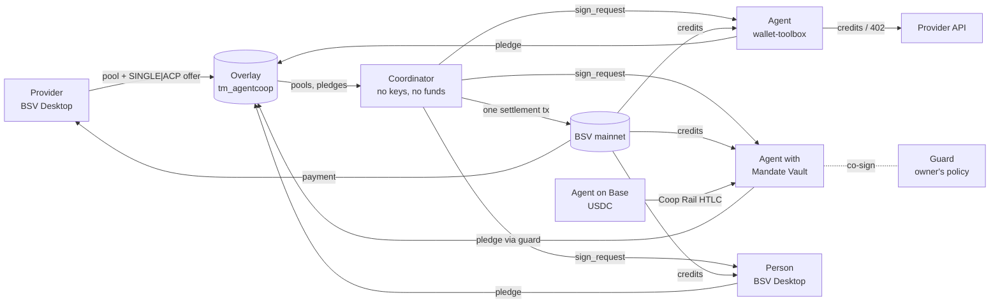

# AgentCoop

**x402 taught agents how to pay. AgentCoop lets many agents buy one block of capacity together, with no deposits, no escrow and no refunds: one atomic BSV transaction pays the provider and delivers every share.**

BSV Blockchain track, "DeFi Rails for Agentic Payments" · TUM Blockchain & AI Hackathon, 30–31 October 2026

> Status (30 Oct, evening): every flow below runs end to end on the wallet-toolbox **mock chain** with the real components (`npm test`: 55 files, 267 tests). **No mainnet transaction yet**: we are waiting for satoshis. The example transaction table fills in as the mainnet runs happen.

## What it does

AI agents buy paid APIs, LLM tokens and GPU time one call at a time, at list price. The real discounts (reserved GPU blocks, provisioned throughput, plan tiers) sit behind large upfront commitments that small teams cannot make. Group buying would fix that, but today it always means putting everyone's money with an intermediary.

AgentCoop is a **non-custodial group-buying layer** on BSV. A provider announces a pool ("1,000 GPU-hours for 25,000 sats") and pre-signs its credits as an open offer. Agents (and people) pledge from their own wallets; until the pool fills, every satoshi stays in its owner's wallet. When it fills, a coordinator assembles **one atomic transaction** that pays the provider and delivers BSV-21 credit tokens to every participant (delivery versus payment). Each participant checks the whole transaction and signs only its own input. The coordinator holds no keys and no money, and anyone can run one.

Credits are spent on the provider's API over HTTP 402 or resold to other agents on an atomic market. An agent's budget can live in an owner-controlled **Mandate Vault** (agent + guard 2-of-2, owner can always withdraw alone), so a prompt-injected agent cannot spend outside its owner's policy. Agents holding USDC on Base can join through **Coop Rail**, an HTLC swap into BSV (offline proof of concept).



## Usage & value note

**Problem.** AI agents buy compute, model capacity and data one call at a time. The packages with real discounts (reserved GPU blocks, provisioned throughput, enterprise data plans) require large upfront commitments small teams cannot make, and pooling today means trusting an intermediary with everyone's money.

**What AgentCoop is.** A non-custodial group-buying layer on BSV. Providers publish a pool and pre-sign their credits as an open offer. Agents pledge from their own wallets; when the pool fills, a single atomic transaction pays the provider and delivers BSV-21 credits to every participant. No deposits, no escrow, no refunds. Credits are spent on the provider's API over HTTP 402 or resold on an atomic secondary market. Agent budgets live in owner-controlled Mandate Vaults, and agents holding USDC on Base can join via an atomic swap.

**What we prove on chain.** N independent parties, one transaction, zero satoshis held by any intermediary at any point, and delivery versus payment in the same transaction. On the mock chain: 100 participants in one 36.5 kB settlement for 3,670 sat, and 50 participants of which 10 pledge from Mandate Vaults through the guard (19.75 kB, 1,986 sat); `custodiedSats` is computed from the chain, not assumed. Demo pricing is illustrative; the mechanism is real.

**Target users.** Small AI teams and agent operators (buyers); AI infra resellers, LLM routers, GPU and data providers (sellers, who get pre-paid, all-or-nothing demand before they buy capacity); liquidity providers (underwriters).

**How people use it.** A provider opens a pool from BSV Desktop with `provider-cli`. An agent owner funds a Mandate Vault and sets a policy with `owner-cli`. Agents find pools on the overlay, decide with their forecast, pledge, sign the settlement and spend credits over 402. People join from the web app with BSV Desktop.

**Value for BSV.** New users and liquidity from other chains (x402 agents on Base), recurring multi-party settlement transactions, tradable BSV-21 credit markets, and per-call micropayment volume. All of it is practical only because BSV makes multi-party atomic transactions and cent-sized payments cheap.

## How it meets the track requirements

| Requirement (TBC26 §3) | How | Where |
|---|---|---|
| BSV TypeScript SDK + Wallet Toolbox | Every transaction is built with `@bsv/sdk` 3.2.1; agents, provider API, guard, coordinator tests and maker use `@bsv/wallet-toolbox` 2.14.9 | `packages/core`, `apps/*` |
| User-facing flows on BSV Desktop / Browser | Provider (open pool, mint), owner (vault, policy, withdraw), people (pledge) use `WalletClient('auto')` | `apps/provider-cli`, `apps/owner-cli`, `apps/participant-cli`, `apps/web` |
| Real transactions (mainnet) | Pool, pledge, settlement, redeem, 402, sweep, vault, rail: see the table below | ☐ pending satoshis |
| Non-custodial wherever funds are involved | One atomic DvP transaction; the coordinator holds nothing; vault funds need agent + guard and the owner can always exit | [docs/THREAT-MODEL.md](docs/THREAT-MODEL.md) |
| At least one AI agent that pays | Three agents forecast demand, pledge, sign the settlement, redeem credits and pay retail over 402; an LLM brain is optional | `apps/agents` |

## Quick start (mock chain: no wallet, no satoshis)

Node 22 or newer. Every command below was run on a fresh container on 30 Oct.

```bash
npx npm@11 install        # npm 10.9 cannot install this workspace; npm 11 can
```

```bash
npm test                  # 55 files: protocol, overlay, coordinator, agents, guard, rail, web
```

```bash
npm run demo:k1           # 3 agents forecast, pledge and settle one pool, then spend credits on the provider API
```

```bash
npm run demo:failed-pool  # an unfilled pool costs nothing but the registration fee; the agent withdraws and joins a right-sized pool
```

```bash
npm run demo-injection -w @agentcoop/scripts   # prompt injection: the guard refuses "100% of the budget into pool X"
```

```bash
npm run infra             # overlay :8080 + coordinator :8090 (WS /ws), persistent data/
```

```bash
npm run web:mock          # the web app with a scripted mock Desktop
```

## Mainnet run

Not done yet (no satoshis). The steps, each first with ≤ 1,000 sat:

1. Server wallet keys: `npx tsx scripts/keygen.ts --only-missing >> .env` (keys stay in `.env`, which is git-ignored).
2. Fund them from the treasury BSV Desktop: `npm run fund -w @agentcoop/scripts -- agent-1=1000 --dry-run`, then without `--dry-run`.
3. `npm run infra`, `npm run provider`, `npm run guard -w @agentcoop/guard`.
4. Provider: `npm run provider-cli -- mint …` and `open-pool` from BSV Desktop.
5. Agents: `npm run agents`. Owner: `npm run owner -w @agentcoop/owner-cli -- create-vault | policy | fund | withdraw`.
6. Coop Rail (Base Sepolia → BSV, ≤ 1 USDC / ≤ 1,000 sat): `npm run deploy -w @agentcoop/maker -- --yes`, then `npm run swap-demo -w @agentcoop/maker -- --vault <vaultId>` (dry run: checks keys, balances, guard and vault), then the same with `--yes`. See [docs/RAIL-POC.md](docs/RAIL-POC.md).

Operations guide: [docs/OPS.md](docs/OPS.md). Public deployment of the overlay and coordinator: [infra/README.md](infra/README.md).

## Example transactions

| # | Transaction | Signed by | What you see on chain | Mainnet txid | Mock-chain test |
|---|---|---|---|---|---|
| T1 | Credit token deploy | Provider (BSV Desktop) | BSV-21 deploy+mint (also on BananaBlocks) | pending | `test/skeleton.mockchain.test.ts` |
| T2 | Pool announcement, credits reserved | Provider | N-credit UTXO + `OP_RETURN agentcoop pool` | pending | `test/skeleton.mockchain.test.ts` |
| T3 | Pledge | Agent / person | Pledge coin, registration fee to the provider, `OP_RETURN agentcoop pledge` | pending | `test/skeleton.mockchain.test.ts` |
| T4 | Pledge cancel | Pledge owner | The coin spent back to its owner | pending | `test/skeleton.mockchain.test.ts` |
| **T5** | **Settlement (DvP)** | Provider SINGLE\|ACP, everyone ALL | **N inputs; provider paid and every participant's credits in one tx; pledge-list hash** | pending | `apps/coordinator/test/e2e.integration.mockchain.test.ts` |
| T6 | Credit redeem and return | Agent / provider | BSV-21 transfer to the provider, and back | pending | `test/provider.credits.mockchain.test.ts` |
| T7 | Retail 402 payment | Agent (AuthFetch) | BRC-29 payment to the provider | pending | `test/provider.402.mockchain.test.ts` |
| T8 | Market sweep | Sellers SINGLE\|ACP, buyer ALL | Several sellers paid, buyer gets credits | pending | `test/market.mockchain.test.ts` |
| T9 | Vault funding and owner withdrawal | Owner (BSV Desktop) | Vault script output; spend through the `OP_IF` branch | pending | `test/vault.mockchain.test.ts` |
| T10 | Guard-approved payment | Agent + guard 2-of-2 | Spend through the multisig branch | pending | `test/vault.mockchain.test.ts` |
| T11 | Coop Rail, BSV side | Maker funding; agent + guard claim | Hash-locked output; the claim reveals the preimage | pending | `test/e2e.rail.mockchain.test.ts` |
| T11b | Coop Rail, Base side | Agent lock, maker claim | HTLC contract on BaseScan | pending (Base Sepolia) | `apps/maker/test/htlc.evm.test.ts` |

## Non-custodial design and threat model

Nobody holds anybody's money at any point: until settlement a pledge coin is in its owner's wallet, and the settlement both pays and delivers. The coordinator has no keys. Participants and the guard verify the credit lineage themselves instead of trusting the overlay. What is not closed is stated as such:

- **Detectable, not prevented:** a coordinator's choice of whom to include (deterministic order, pledge-list hash on chain, an audit endpoint, and any coordinator can close any pool).
- **Open, bounded:** a provider that takes payment but does not serve (credits are resellable), a redeemed balance held off chain (≤ 20 credits), a compromised agent and guard together (bounded by the vault balance), BRC-100 hash signing (one active pledge).
- **Partly closed:** an agent selling its credits to escape the guard. Vault pledges can lock their credits to the vault (agent + guard to move them); the guard's spending policy for those credits is still to come.
- **Open:** no reverse direction for Coop Rail.

Every threat, its control, and the test that exercises it: [docs/THREAT-MODEL.md](docs/THREAT-MODEL.md).

## What is real and what is simulated

| Real | Simulated |
|---|---|
| Every payment, pledge, settlement, credit token, market listing, vault and HTLC is a real BSV transaction built with the SDK (on the mock chain until the mainnet run) | The GPU jobs: the provider API runs a simulator (queue, GPU log, reproducible result hash) |
| Signatures, sighash scopes, lineage checks, overlay admission rules, the guard's policy checks | Prices are illustrative ("demo pricing") |
| The Base HTLC contract (compiled with solc 0.8.37, run in an in-memory EVM in tests) | The Base side is not deployed yet (Base Sepolia pending) |

## Components

| Component | Track | What it is | README |
|---|---|---|---|
| `packages/core` | A | Protocol core: pool, offer, pledge, settlement builders, `verifySettlementPlan`, `verifyLineage`, market, vault and HTLC scripts | — |
| `packages/overlay` | B | `tm_agentcoop` / `ls_agentcoop`: BSV-21 rules + pool, pledge, settlement, vault, offer records | [README](packages/overlay/README.md) |
| `apps/coordinator` | B | Signing rounds over WebSocket, side API, audit and custody metrics | [README](apps/coordinator/README.md) |
| `apps/provider-api`, `apps/provider-cli` | C | Simulated GPU provider (402 + credit redeem) and its BSV Desktop CLI | [api](apps/provider-api/README.md), [cli](apps/provider-cli/README.md) |
| `apps/agents`, `apps/participant-cli` | C | Forecasting agents (rules or LLM brain), human participant CLI | [agents](apps/agents/README.md), [cli](apps/participant-cli/README.md) |
| `apps/guard`, `apps/owner-cli` | D | Mandate Vault guard (policy engine, co-signer) and the owner's CLI | [guard](apps/guard/README.md), [owner](apps/owner-cli/README.md) |
| `apps/maker`, `contracts/` | D | Coop Rail: Base HTLC, BSV HTLC, maker server | [RAIL-POC](docs/RAIL-POC.md) |
| `apps/web` | E | Consoles for providers, owners, participants and observers, plus a pixel-art live view | [README](apps/web/README.md) |
| `infra/` | B | Running the overlay and coordinator, public deployment | [README](infra/README.md) |

<!-- Each track replaces its row's text with its own paragraph (STATUS: D → A/B/C/E, 30 Oct). -->

## Known limitations

- No mainnet transaction yet; validations 2–6 (BSV Desktop SINGLE\|ACP signing, vault script policy, nLockTime semantics, v1 malleability) are written and wait for satoshis.
- Coop Rail is an offline proof of concept: the Base contract is not deployed and no live swap has run.
- Vault-locked credits can be delivered but not yet spent through the guard (threat T-10), and Coop Rail has no reverse direction.
- The coordinator's selection is auditable but cannot be forced.

## License

MIT (the `LICENSE` file is still to be added).
