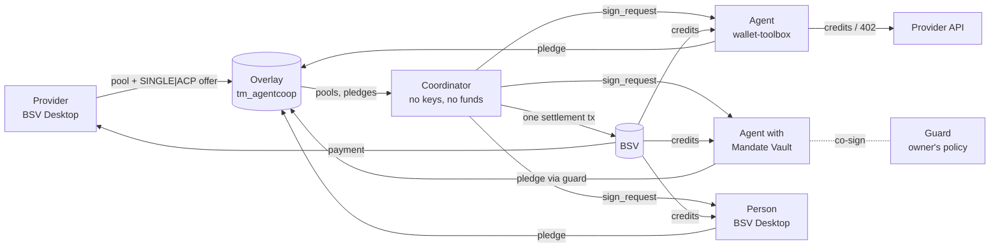

# AgentCoop

[](https://github.com/kagancoplu/ProfessionarLARPERs/actions/workflows/ci.yml)

**x402 taught agents how to pay. AgentCoop lets many agents buy one block of capacity together, with no deposits, no escrow and no refunds: one atomic BSV transaction pays the provider and delivers every share.**

AgentCoop is a non-custodial group-buying protocol for AI agents (and people) on the BSV blockchain. It is open source (MIT) and experimental: it has run on mainnet with small amounts and has not had an external security audit.

**Web app:** <https://professionar-larpe-rs.vercel.app/?mode=mock> runs the scripted walkthrough in your browser with no wallet. The proof that the protocol runs on real BSV is the [mainnet transactions](#on-mainnet).

Not a programmer? Read [the plain-language overview](docs/overview.md).

## The problem

AI agents buy GPU time, model capacity and paid APIs one call at a time, at list price. The real discounts (reserved GPU blocks, provisioned throughput, plan tiers) sit behind large upfront commitments that small teams cannot make alone. Group buying would fix that, but today it means putting everyone's money with an intermediary who waits for the group to fill and refunds it if the deal falls through.

AgentCoop is for small AI teams and agent operators who buy, and for GPU, data and model-capacity providers and resellers who sell: they get prepaid, all-or-nothing demand before they commit to capacity.

## How AgentCoop works

1. A **provider** announces a pool ("40 GPU-hours for 1,000 sats") and pre-signs its credits as an open offer: "anyone may take these credits in a transaction that pays me this price".
2. **Agents and people pledge** from their own wallets. Until the pool fills, every satoshi stays a coin in its owner's wallet, and anyone can withdraw.
3. When the pool fills, a **coordinator** assembles **one transaction** that pays the provider and delivers BSV-21 credit tokens to every participant (delivery versus payment). Each participant checks the whole transaction, including the credits' lineage back to the token deploy, and signs only its own input. The coordinator holds no keys and no money, and anyone can run one.
4. If the pool does not fill, nothing is broadcast.

Credits are spent on the provider's API (redeemed, or bypassed with pay-per-call HTTP 402) or resold to other agents in one atomic transaction. An agent's budget can sit in an owner-controlled **Mandate Vault**: agent and guard sign together under the owner's policy, and the owner can always withdraw alone, so a prompt-injected agent cannot spend outside its mandate.



More: [concepts](docs/concepts/pools-and-settlement.md) · [architecture](docs/architecture.md) · [protocol reference](docs/reference/protocol.md).

## What it does

- **Pools with atomic settlement:** N participants, one transaction, the provider paid and every participant's credits delivered in it; deterministic selection with an on-chain pledge-list hash, an audit endpoint, and a `custodiedSats` metric computed from the chain.
- **Credits:** one BSV-21 token per product, verified by lineage rather than by trusting an indexer; spent through capped redemption or HTTP 402 (BRC-105).
- **A market:** signed `SINGLE|ANYONECANPAY` listings, swept atomically.
- **Mandate Vault:** a 2-of-2 vault with a policy co-signer and an owner exit; credits bought from a vault can stay locked to it.
- **Lighthouse pledges:** a person signs once and leaves; a named guard co-signs the settlement after the same checks.
- **Autonomous agents:** three agents that forecast their need, decide with a rules or LLM brain behind a policy enforced in code, pledge, verify and sign, redeem, pay retail and trade.
- **Coop Rail (proof of concept):** an HTLC swap from USDC on Base into an agent's vault.
- **A web app** with consoles for providers, participants and vault owners, and a pixel-art Town that shows the protocol live; every signature is a BSV Desktop approval.

## Maturity

| | Status |
|---|---|
| Pools, pledges, settlement through the coordinator, Lighthouse settlement, vault agent settlement with vault-locked credits, redeems, 402 payments, the Mandate Vault (owner exit, agent + guard spend, an injected payment refused), the market sweep | **Run on BSV mainnet** (30–31 October 2026) |
| Every flow above, plus a 100-participant settlement, a second independent coordinator, the public-edge limits | **Mock chain**, with the real components, in CI on every push |
| Coop Rail | **Offline proof of concept**: mock chain and in-memory EVM; the Base contract is not deployed |
| The provider's GPU and proxy work | **Simulated**: payments, credits and settlement are real; the work is a simulator |
| Prices | **Illustrative** ("demo pricing"): the mechanism is real, a saving is not claimed |
| The web app's wallet flows with BSV Desktop on mainnet | Tested end to end on the mock chain; people joined mainnet pools with `participant-cli` |
| Public hosting of the services | Deployment scripts exist ([infra](infra/README.md)); no public instance is documented as running |

Known limits: a provider can sell credits and not serve them (bounded by the pool price, credits are resellable); a coordinator's selection is auditable but cannot be forced; Coop Rail has no reverse direction. The full list, with every threat's control and test: [docs/THREAT-MODEL.md](docs/THREAT-MODEL.md).

## On mainnet

| What | Transaction |
|---|---|
| A pool settles through the coordinator's signing round: 2 agents and 1 person, one transaction, audit `consistent`, `custodiedSats: 0` | [5314ab8b9f…](https://whatsonchain.com/tx/5314ab8b9fc731c824fd49a0bbb6a69bb0f57ad2fff11dda656d40eb6584a185) |
| A vault agent's settlement: the guard co-signs, the credits land on the vault script | [08a6455612…](https://whatsonchain.com/tx/08a6455612925df713c4738b450d3018ee689ad9fcb064dbfb3555603ba47db5) |
| A Lighthouse settlement: the person signed once and went offline | [83d339b896…](https://whatsonchain.com/tx/83d339b8963c0f12cc038fc65e751be077386bee3ea045f5cc526e2cb9cd585c) |
| An agent pays per call over HTTP 402 | [5176e9eeb8…](https://whatsonchain.com/tx/5176e9eeb8604d83ba6154f10ddaf8e8dee66ad185338b0127f2fbf2efcf853f) |
| A market sweep, lineage verified before paying | [675c333414…](https://whatsonchain.com/tx/675c33341427325ac458c40e1a0e35ba25995b4ca3653297ca1fe1348ee7231c) |

Every transaction type, the mainnet validation tests and the full ledger: [docs/reference/transactions.md](docs/reference/transactions.md). On the mock chain, 100 participants settled in one 36.5 kB transaction for 3,670 sat.

## Quick start (offline: no wallet, no satoshis)

Node 22 or newer and npm 11 (npm 10.9 cannot install this workspace).

```bash
npx npm@11 install
npm test                  # every package on wallet-toolbox's mock chain
npm run demo              # a provider opens a pool, 3 agents pledge, one settlement, credits spent and traded
npm run demo:injection    # a prompt-injected vault agent: its policy vetoes; with that bypassed, the guard refuses
npm run web:mock          # the web app at http://localhost:5173 with a scripted mock BSV Desktop
```

Next steps, including the live stack: [docs/getting-started.md](docs/getting-started.md). Running with real satoshis: [docs/OPS.md](docs/OPS.md).

## Repository

| Path | What |
|---|---|
| [`packages/core`](packages/core/README.md) | Protocol library: builders, signers, settlement verifier, lineage, scripts |
| [`packages/overlay`](packages/overlay/README.md) | Overlay topic `tm_agentcoop` and lookup service `ls_agentcoop` |
| [`apps/coordinator`](apps/coordinator/README.md) | Signing rounds over WebSocket, offers, listings, audit, metrics |
| [`apps/guard`](apps/guard/README.md), [`apps/owner-cli`](apps/owner-cli/README.md) | Mandate Vault co-signer and the owner's CLI |
| [`apps/provider-api`](apps/provider-api/README.md), [`apps/provider-cli`](apps/provider-cli/README.md) | Simulated provider API and the provider operator's CLI |
| [`apps/agents`](apps/agents/README.md), [`apps/participant-cli`](apps/participant-cli/README.md) | Autonomous agents and the CLI for people |
| [`apps/maker`](apps/maker/README.md), `contracts/` | Coop Rail maker and the Base HTLC |
| [`apps/relay`](apps/relay/README.md) | Optional Supabase mirror for the web (display only) |
| [`apps/web`](apps/web/README.md) | Web consoles and the Town |
| [`infra`](infra/README.md), `scripts/`, `supabase/` | Operations, validation scripts, mirror schema |
| [`docs`](docs/README.md) | Documentation |

## Security

User keys never leave BSV Desktop or BSV Browser; server keys come from a git-ignored `.env`. [docs/AUDIT-READINESS.md](docs/AUDIT-READINESS.md) is the package for an auditor: value at risk, trust boundaries, scope, 16 invariants tied to code and tests, our own findings (F-1 to F-11), scans and mainnet evidence. `npm run check:docs` fails CI if a file or test cited there stops existing. Report vulnerabilities as [SECURITY.md](SECURITY.md) describes; use small amounts only.

## Status of the project

AgentCoop is a finished hackathon project, published as is. Known gaps and the work that would come next are in [docs/ROADMAP.md](docs/ROADMAP.md).

## Origin

AgentCoop was built at the TUM Blockchain & AI Hackathon (30–31 October 2026), BSV Association track "DeFi Rails for Agentic Payments". The original design notes and plans are kept in [docs/archive/hackathon-2026](docs/archive/hackathon-2026/README.md).

## License

MIT, see [LICENSE](LICENSE).
