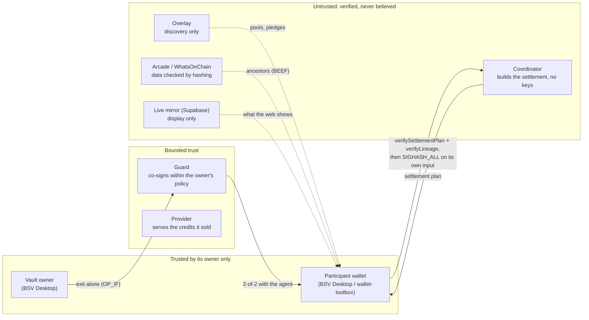

# AgentCoop: audit readiness

This is the package we would hand a security auditor on day one. It covers what the system protects, where the code that protects it lives, the invariants it must keep (each tied to the code that enforces it and the test that exercises it), what we already know is weak, and how to build and test everything offline.

Companion documents: [THREAT-MODEL.md](THREAT-MODEL.md) (23 threats, control, code, test, mainnet evidence), [SECURITY.md](../SECURITY.md) (how to report a vulnerability), [ROADMAP.md](ROADMAP.md) (what an audit gates). Every path and test name cited in these documents is checked by `npm run check:docs`, in CI on every push.

## 1. Why this needs an audit

AgentCoop moves real money between parties who do not trust each other: AI agents, people, providers and agent owners. It does so **without any intermediary holding funds**. That property holds only if a small amount of code is exactly right:

- **The Bitcoin Script templates** (Mandate Vault, vault-locked credits, Lighthouse coins, the HTLC). A wrong opcode here means a guard that can spend alone, an agent that escapes its owner's policy, or coins nobody can spend.
- **The settlement verifier.** Every participant signs `SIGHASH_ALL` over a transaction a coordinator built. The verifier is the only thing standing between the participant and a coordinator that wants to redirect its credits or its change.
- **The guard's policy engine.** It co-signs vault spends for agents that may be prompt-injected. If a check is missing, an injected agent drains its vault within the caps.
- **The overlay's BSV-21 rules and the client-side lineage check.** Credits are tokens; if forgery passes either, people pay for nothing.
- **The Base HTLC** (Solidity), which swaps USDC for BSV and is the project's only EVM contract.

Today the value at risk is small: hackathon pools of a few thousand satoshis, run on mainnet. Before anyone pools real budgets through it, these parts need an independent review.

## 2. System and trust boundaries



| Party | Can it steal? | Why not |
|---|---|---|
| Coordinator | No | The coordinator service loads no wallet key (nothing in `apps/coordinator/src` signs a transaction). Participants rebuild and verify the whole settlement before signing; the provider's offer is `SINGLE\|ANYONECANPAY` and pays only the provider its price. It can censor or reorder, which the audit endpoint detects (T-3). `.env.example` reserves a `WALLET_COORDINATOR_KEY` slot for an identity and broadcast fees; it holds no user funds |
| Overlay | No | Discovery only. Participants and the guard walk credit lineage back to the deploy themselves |
| Guard | No, alone | Vault coins are 2-of-2 agent + guard; the owner exits alone |
| Agent + guard together | Up to the vault balance | The owner funds a weekly budget; caps apply (T-12) |
| Provider | Not the payment | Payment and credits are outputs of one transaction (DvP). It can fail to serve after selling (T-5) and holds at most 20 redeemed credits per agent off chain (T-6) |
| Live mirror | No | Never in a signing or paying path: the browser reads pool terms from the coordinator before it pays (T-22) |

## 3. Scope

Line counts are file lengths including comments (`git ls-files <path> | xargs cat | wc -l`, 31 Oct 2026).

| Priority | Component | Path | Lines | What to look for |
|---|---|---|---|---|
| 1 | Script templates | `packages/core/src/scripts/` | 504 | Vault (`OP_IF` owner branch, bare 2-of-2), vault-locked BSV-21 credits, Lighthouse coins, HTLC (hash + height refund) |
| 1 | Signers and sighash | `packages/core/src/signers/` | 668 | Sighash computation and scope (`ALL`, `SINGLE\|ANYONECANPAY`), what each signer agrees to |
| 1 | Settlement build and verify | `packages/core/src/pool/` | 1,041 | `planSettlement`, `verifySettlementPlan`, offer, pledge, lighthouse |
| 1 | Lineage | `packages/core/src/verify/` | 154 | Overlay-free BSV-21 lineage walk, txid recomputation |
| 1 | Guard | `apps/guard/src/` | 1,794 | Policy checks G1–G13, P1–P6, S1–S7, C, L, H, R ([THREAT-MODEL.md §2](THREAT-MODEL.md)), ledger, rolling caps |
| 1 | Vault operations | `packages/core/src/vault/` | 177 | Funding, owner withdrawal |
| 2 | BSV-21 kit and rules | `packages/core/src/kit/` | 1,175 | Admission rules (inflation, source, cross-token), addresses (BRC-29/42), coin selection |
| 2 | Overlay | `packages/overlay/src/` | 1,265 | Topic manager and lookup service, input limits |
| 2 | Base HTLC | `contracts/base-htlc/HTLC.sol` | 62 | ERC-20 assumptions, timeouts, id derivation (findings F-1 to F-3 below) |
| 2 | Coop Rail maker | `apps/maker/src/` | 861 | Height vs time safety margin (F-4), pre-signed refund |
| 2 | Coordinator | `apps/coordinator/src/` | 2,090 | Signed `hello`, deterministic selection, audit endpoint, WebSocket limits |
| 3 | Provider API | `apps/provider-api/src/` | 1,082 | 402 replay store, redeem checks 1–6 in `apps/provider-api/src/redeem.ts`, prepaid balances |
| 3 | Market | `packages/core/src/market/` | 206 | Signed listings, one-transaction sweep |
| 3 | Browser wallet flows | `apps/web/src/wallet/flows/` | 1,055 | Transactions the web app asks BSV Desktop to sign |

About 11,000 lines of TypeScript and 62 lines of Solidity in priorities 1–3.

**Out of scope:** the web UI outside its wallet flows (`apps/web`), the live mirror relay (`apps/relay`, a read-only view), the simulated job runners (`apps/provider-api/src/runner.ts`, `runners.ts`), the agents' purchasing decisions (`apps/agents`, economics rather than custody), operational scripts (`scripts/`) and the CLIs, which call the same core functions.

## 4. Invariants

Each one names where it is enforced and a test that fails if it breaks. Test names are quoted exactly.

| # | Invariant | Enforced in | Exercised by |
|---|---|---|---|
| I-1 | No party other than the owner ever holds a participant's funds; a settlement pays the provider and delivers every participant's credits in the same transaction | `packages/core/src/pool/plan.ts`, `packages/core/src/pool/settle.ts` | `test/skeleton.mockchain.test.ts` › "T5: assemble, broadcast, overlay admits the credits; agents receive them and their change"; `apps/coordinator/test/e2e.audit-metrics.mockchain.test.ts` › "3. /metrics counts settlements and participants and computes custodiedSats = 0" |
| I-2 | A participant signs a settlement only after verifying all of it: its credits, its change, the provider's price, the fee cap, the pledge-list hash | `packages/core/src/pool/verify.ts` | `packages/core/test/pool.plan.test.ts` › "passes an honest plan and catches each kind of tampering" |
| I-3 | A signature obtained for one plan is useless for another | `packages/core/src/pool/verify.ts`, `packages/core/src/signers/` | `test/skeleton.mockchain.test.ts` › "a coordinator that alters the plan after signing gets nothing valid" |
| I-4 | Credits count only if their lineage walks back to the token's deploy, with every ancestor's txid recomputed | `packages/core/src/verify/lineage.ts` | `packages/core/test/lineage.test.ts` › "refuses a "transfer" minted from plain sats", "refuses inflation, a bad signature on an ancestor, and fetched data that does not hash to the txid" |
| I-5 | The overlay admits no inflation, no transfer minted from plain sats, no token X funding token Y | `packages/core/src/kit/rules.ts` | `packages/core/test/rules.test.ts` › "FORGERY: rejects a "transfer" of a real token minted from plain sats", "FORGERY: an admitted input of token X cannot fund outputs of token Y" |
| I-6 | Vault coins move only with agent + guard, or with the owner alone | `packages/core/src/scripts/vault.ts` | `test/vault.mockchain.test.ts` › "6. the chain itself refuses anything short of agent + guard", "8. the owner withdraws alone (OP_IF branch), without guard or agent" |
| I-7 | The guard co-signs only payments the owner's policy allows: allowlisted providers with payee proofs, per-payment, per-pool and weekly caps | `apps/guard/src/policy.ts`, `apps/guard/src/guard.ts` | `test/vault.mockchain.test.ts` › "4. prompt injection: payment to a provider outside the allowlist → 403, nothing signed or broadcast"; `apps/guard/test/vault.script.test.ts` › "G10–G12: fee, per-payment and weekly caps" |
| I-8 | The guard signs only the sighash it computed itself, and only after the agent signed that same sighash | `apps/guard/src/guard.ts` | `apps/guard/test/vault.script.test.ts` › "G5: the agent must have signed the sighash the guard computes" |
| I-9 | Vault-locked credits leave the vault only to an allowed provider or back into the same vault, and a provider's return puts them back on the vault script | `packages/core/src/scripts/creditLock.ts`, `apps/guard/src/credits.ts`, `apps/provider-api/src/redeem.ts` | `test/vault-credits.spend.mockchain.test.ts` › "redeem refusals: a provider not allowed, the agent's own address (guard bypass), burning, another vault"; `test/agents.vault.mockchain.test.ts` › "its credits are locked to the vault; it redeems them with the guard; a return goes back to the vault" |
| I-10 | `creditLock` and Lighthouse `mode` come from each pledge's on-chain record, never from the coordinator's plan | `packages/core/src/pool/verify.ts` | `test/e2e.vault-credits.mockchain.test.ts` › "a coordinator cannot flip the lock: unlocking V (guard bypass) or locking P are both refused" |
| I-11 | An offline Lighthouse pledger's coin cannot be taken with its signature alone | `packages/core/src/pool/lighthouse.ts`, `apps/guard/src/lighthouse.ts` | `test/e2e.lighthouse.mockchain.test.ts` › "a thief with only the human's signature cannot take the coin (fake credit output, the rest to itself)" |
| I-12 | A 402 payment and a redeem transfer are each accepted once; a redeem moves at most 20 credits and leaves at most 20 pending | `apps/provider-api/src/app.ts`, `apps/provider-api/src/redeem.ts`, `apps/provider-api/src/credits.ts` | `test/provider.402.mockchain.test.ts` › "answers 402 with the price, and refuses a replayed payment (409)"; `test/provider.credits.mockchain.test.ts` › "refuses to redeem the same transfer twice (409)", "refuses a redeem of more than 20 credits" |
| I-13 | Only an identity that signed the coordinator's per-connection nonce receives or answers a `sign_request` | `apps/coordinator/src/auth.ts`, `apps/coordinator/src/ws.ts` | `apps/coordinator/test/e2e.public-edge.mockchain.test.ts` › "an attacker using the victim's identity without proof gets no sign_request and cannot reject for the victim" |
| I-14 | A Coop Rail claim on BSV needs agent + guard, and the guard signs it only if the sats land in the agent's registered vault | `apps/guard/src/rail.ts`, `packages/core/src/scripts/htlc.ts` | `test/e2e.rail.mockchain.test.ts` › "the agent refuses a refund it should not sign; the guard refuses claims that skip the vault or belong to someone else" |
| I-15 | Base HTLC: a claim needs the preimage before the timeout and always pays the receiver; a refund needs the timeout and always pays the sender; locks of the same token are isolated | `contracts/base-htlc/HTLC.sol` | `apps/maker/test/htlc.evm.test.ts` › "lock → claim with the secret pays the receiver; wrong secret, double claim and early refund revert"; `apps/maker/test/htlc.boundaries.evm.test.ts` › "claim at exactly the timeout reverts; refund one second before it reverts, at it succeeds", "two locks of the same token are isolated: claiming one leaves the other's tokens in the contract", "whoever calls, a claim pays the receiver and a refund pays the sender" |
| I-16 | The browser never pays according to data from the live mirror | `apps/web/src/wallet/flows/live.ts` | `test/web.live-flows.mockchain.test.ts` › "a pledge pays the pool's real fee script even when the store holds tampered terms (e.g. from the Supabase mirror)" |

**How strong are these tests?** For the Base HTLC we checked: five hand-made mutants of `HTLC.sol` (claim deadline `<` → `<=`, refund `>=` → `>`, no duplicate-lock check, claim paying the caller, no zero-amount check), each recompiled and run against `apps/maker/test/htlc.boundaries.evm.test.ts`. All five were caught; the committed contract was restored unchanged. The rest of the suite has not been mutation-tested yet.

## 5. Assumptions

- **Wallets keep keys.** User keys never leave BSV Desktop or BSV Browser; transactions are built with `createAction`/`signAction` and custom inputs signed with `createSignature`. Server wallets (provider API, guard, agents, maker) load a 64-hex root key from environment variables (`.env`, git-ignored).
- **SPV and data sources.** Ancestors fetched from Arcade or WhatsOnChain are trusted only after their txids are recomputed from the bytes.
- **The overlay is honest about nothing.** It is used for discovery; every check that matters is repeated client-side.
- **BRC-100 wallets sign what they are asked.** A wallet asked to sign a sighash (`createSignature` with `hashToDirectlySign`) does not see the transaction; the guard computes the sighash itself (I-8) and agents hold at most one active pledge (T-13).
- **Block times average about ten minutes** (Coop Rail's height-based refund, F-4).
- **USDC is a standard ERC-20** (no transfer fee, returns `bool`) on the Base side (F-1, F-2).

## 6. What we already know

Our own review, before any external one. Severity is our estimate of the effect today; the line references are to the current `main`.

| # | Finding | Where | Severity | Status |
|---|---|---|---|---|
| F-1 | `lock` records `amount` without measuring what the contract received. With a fee-on-transfer or rebasing token, a claim or refund pays out more than that lock brought in, drawn from other locks of the same token | `contracts/base-htlc/HTLC.sol:39-40` | Low while the rail is USDC-only; Medium if arbitrary tokens are accepted | Open. Fix: credit the balance delta, or allowlist tokens |
| F-2 | `require(IERC20(token).transfer(...))` expects a `bool`; a token that returns nothing makes `lock` revert (nothing is lost, the token just cannot be used) | `contracts/base-htlc/HTLC.sol:40`, `:50`, `:59` | Informational | Open. Fix: a safe-transfer wrapper |
| F-3 | The lock id has no nonce, so a second lock with identical parameters is refused (`lock exists`) | `contracts/base-htlc/HTLC.sol:37-38` | Informational | Tested; callers vary the timeout |
| F-4 | Coop Rail mixes clocks. The BSV HTLC script has no timelock: its claim branch (agent + guard with the preimage) never expires, and the maker's refund is a pre-signed transaction with nLockTime 6 blocks ahead. The Base lock expires by timestamp; the maker requires ≥ 3 h left before funding. The agent can claim on BSV (revealing the secret) until the maker's refund is mined; if the Base timeout has passed by then, the agent also refunds its USDC. Safe while the maker broadcasts its refund as soon as it is final and blocks are not much slower than 10 minutes | `packages/core/src/scripts/htlc.ts`, `apps/maker/src/rail.ts:34-35`, `apps/maker/src/rail.ts:55` | Medium for a production rail; the PoC is offline and capped | Open; validations 4 and 6 (nLockTime semantics, v1 malleability) are still to run on mainnet |
| F-5 | The guard counts a spend against the caps when it signs, not when it is mined: a signed but never broadcast spend still uses budget. Its decision log has no txid (the final txid is unknown at signing time) | `apps/guard/src/store.ts` | Informational (errs on the safe side) | Accepted |
| F-6 | A provider can sell credits and not serve them | — | Bounded by the pool price; credits are resellable | T-5, open: provider bond and reputation on the roadmap |
| F-7 | Redeemed prepaid balances live in the provider's file (`data/provider/balances.json`, written atomically) | `apps/provider-api/src/credits.ts` | Bounded: ≤ 20 credits per agent | T-6, accepted for now |
| F-8 | The live mirror exposes each service probe's error text (`live_health.detail`, which can include internal URLs) to anonymous readers; Town `move` broadcasts are not validated (cosmetic) | `apps/relay/src/sources.ts`, `apps/web/src/town/multiplayer.ts` | Low (information disclosure; no funds) | Open |
| F-9 | The coordinator's choice of whom to include in a pool is detectable (deterministic order, pledge-list hash on chain, audit endpoint) but not prevented; anyone can run a second coordinator for the same pool | `apps/coordinator/src/audit.ts` | By design | T-3 |

## 7. Dependencies and secrets

Run on 31 Oct 2026; commands included so anyone can repeat them.

- **Private keys in git history: none.** `git log --all -p` searched for Supabase secret keys, 64-hex `*KEY=` assignments, PEM private keys, WIF keys and JWTs. The only hit is a fake value in a test (`apps/relay/test/config.test.ts`, `sb_secret_value_that_must_not_leak`), which checks that the relay never prints its key. No `.env`, `data/` or wallet database has ever been committed.
- **`npm audit --omit=dev`** (runtime dependencies): 3 high, 0 critical.
  - `zod` < 4.6.6, [GHSA-mrhx-c7xc-m3w5](https://github.com/advisories/GHSA-mrhx-c7xc-m3w5) (memory exhaustion on oversized collections), reached through `@anthropic-ai/sdk` (optional LLM brain) and `viem` (maker). Neither validates attacker-supplied collections in our flows.
  - `tmp`, [GHSA-7c78-jf6q-g5cm](https://github.com/advisories/GHSA-7c78-jf6q-g5cm), reached through `solc`, the Solidity compiler, at compile time only.
- **Full tree:** a further 29 high advisories, all under `jimp`, which `free-tex-packer-core` pulls in to pack the web app's sprites at build time. None ships to users.
- **Pinned versions.** The BSV stack is pinned exactly (`@bsv/sdk` 3.2.1, `@bsv/wallet-toolbox` 2.14.9, `@bsv/overlay` 2.6.4); tests load a single copy of the SDK.

## 8. Evidence on mainnet

Real transactions, real wallets, BSV Desktop for the provider, the owner and a human participant. Full table: README › Example transactions.

| What | Transaction |
|---|---|
| Settlement through the coordinator's signing round (agents and a human), audit `consistent`, `custodiedSats: 0` | [5314ab8b9f…](https://whatsonchain.com/tx/5314ab8b9fc731c824fd49a0bbb6a69bb0f57ad2fff11dda656d40eb6584a185) |
| A vault agent's credits land on its vault script | [08a6455612…](https://whatsonchain.com/tx/08a6455612925df713c4738b450d3018ee689ad9fcb064dbfb3555603ba47db5) |
| Lighthouse settlement, humans offline, the guard co-signing | [83d339b896…](https://whatsonchain.com/tx/83d339b8963c0f12cc038fc65e751be077386bee3ea045f5cc526e2cb9cd585c) |
| Vault-locked credits redeemed by agent + guard, the rest stays locked | [4390605025…](https://whatsonchain.com/tx/4390605025d780616cd11389b5b4941d948bace923aa3821d8b7ab5a6b9af51b) |
| The owner withdraws alone through `OP_IF` | [3b7b0a49c1…](https://whatsonchain.com/tx/3b7b0a49c174c4705ebf31c2645e87f101803ca770136998030c7f308dec1b45) |
| An allowed vault payment after an injected one was refused (403) | [a7747d4654…](https://whatsonchain.com/tx/a7747d465417ab96129071344f70f973fb4244eba264cab59d69d19eb39a2108) |
| Agent pays retail over HTTP 402 (BRC-105) | [5176e9eeb8…](https://whatsonchain.com/tx/5176e9eeb8604d83ba6154f10ddaf8e8dee66ad185338b0127f2fbf2efcf853f) |

Not yet on mainnet: the market sweep (T8), Coop Rail (T11, T11b), validations 3, 4 and 6.

## 9. Build and test

Node ≥ 22 (24 recommended). Everything runs offline on the wallet-toolbox mock chain; no wallet or satoshis needed.

```bash
npx npm@11 install        # npm 10.9 cannot install this workspace
npm run typecheck
npm test                  # every package, mock chain
npm run check:docs        # every path and test cited in the security docs exists
npx vitest run apps/maker/test           # the Base HTLC on an in-process EVM
```

CI runs the same steps on every push (`.github/workflows/ci.yml`).

## 10. Reviews so far

- **Per-track checkpoints** at the end of each phase (`plan/STATUS.md`), each phase closed with its mock-chain tests green.
- **Live mirror layer (31 Oct):** an independent review of the Supabase layer found one critical issue: the browser took a pool's fee script from its store, which the mirror fills, so a tampered mirror could redirect a pledge's fee. Fixed in `cffaaee` (the browser now reads the terms from the coordinator), with a regression test (I-16). Nine further issues were fixed in `404a164`, `78bfb0e` and `cc02f38`.
- **This package (31 Oct):** our own review of the Base HTLC and the Coop Rail (F-1 to F-4), the dependency and secret scans (§7), and mutation testing of the HTLC tests (§4).

## 11. What we would ask an auditor to focus on

1. Can a coordinator build a settlement that passes `verifySettlementPlan` for one participant but moves that participant's credits or change elsewhere?
2. Do the vault and credit-lock scripts admit any spend path besides agent + guard and the owner alone, for example through sighash flags or a malformed multisig?
3. Can a sequence of guard requests, each within policy, add up to more than the owner's caps (races, reservations, a signed-but-unbroadcast spend replaced by another)?
4. Can a forged BSV-21 output pass the overlay rules or `verifyLineage`?
5. Is the Coop Rail safe across both chains: F-1 to F-4, the pre-signed v1 refund, nLockTime height semantics?
6. Does the provider's redeem accept a transfer it should not (checks 1–6 in `apps/provider-api/src/redeem.ts`)?
