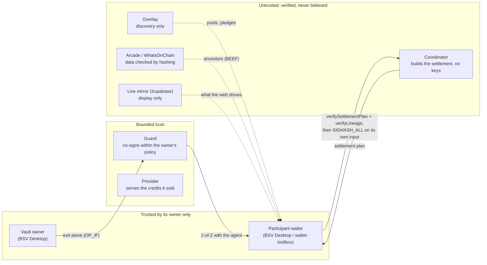

# AgentCoop: audit readiness

This is the package we would hand a security auditor on day one. It covers what the system protects, where the code that protects it lives, the invariants it must keep (each tied to the code that enforces it and the test that exercises it), what we already know is weak, and how to build and test everything offline.

Companion documents: [THREAT-MODEL.md](THREAT-MODEL.md) (23 threats, control, code, test, mainnet evidence), [SECURITY.md](../SECURITY.md) (how to report a vulnerability), [ROADMAP.md](ROADMAP.md) (what an audit gates). Every path and test name cited in these documents is checked by `npm run check:docs`, in CI on every push.

## 1. Why this needs an audit

AgentCoop moves real money between parties who do not trust each other: AI agents, people, providers and agent owners. It does so **without any intermediary holding funds**. That property holds only if a small amount of code is exactly right:

- **The Bitcoin Script templates** (Mandate Vault, vault-locked credits, Lighthouse coins, the HTLC). A wrong opcode here means a guard that can spend alone, an agent that escapes its owner's policy, or coins nobody can spend.
- **The settlement verifier.** Every participant signs `SIGHASH_ALL` over a transaction a coordinator built. The verifier is the only thing standing between the participant and a coordinator that wants to redirect its credits or its change.
- **The guard's policy engine.** It co-signs vault spends for agents that may be prompt-injected. If a check is missing, an injected agent drains its vault within the caps.
- **The overlay's BSV-21 rules and the client-side lineage check.** Credits are tokens; if forgery passes either, people pay for nothing.
- **The Base HTLC** (Solidity), which swaps USDC for BSV and is the project's only production EVM contract (`contracts/base-htlc/MockUSDC.sol` is for tests).

Today the value at risk is small: hackathon pools of a few thousand satoshis, run on mainnet. Before anyone pools real budgets through it, these parts need an independent review.

## 2. System and trust boundaries



| Party | Can it steal? | Why not |
|---|---|---|
| Coordinator | No | The coordinator service loads no wallet key (nothing in `apps/coordinator/src` signs a transaction). Participants rebuild and verify the whole settlement before signing; the provider's offer is `SINGLE\|ANYONECANPAY` and pays only the provider its price. It can censor or reorder, which the audit endpoint detects (T-3). `.env.example` reserves a `WALLET_COORDINATOR_KEY` slot for an identity and broadcast fees; it holds no user funds |
| Overlay | Not participants' coins | Participants and the guard walk credit lineage back to the deploy themselves. The provider API does trust it for redeem check 4 (who sent the credits) and for vault records (`apps/provider-api/src/redeem.ts:145-147`, `apps/provider-api/src/redeem.ts:196-198`), so a lying overlay could credit a redeem to the wrong identity (≤ 20 credits each) |
| Guard | No, alone | Vault coins are 2-of-2 agent + guard; the owner exits alone |
| Agent + guard together | Up to the vault balance | The owner funds a weekly budget; caps apply (T-12) |
| Provider | Not the payment | Payment and credits are outputs of one transaction (DvP). It can fail to serve after selling (T-5) and holds at most 20 redeemed credits per agent and credit token off chain (T-6). A redeem refused after its transfer was broadcast (over the cap, a failed lineage fetch) leaves the credits at the provider's address, uncredited, until the agent posts that transfer again |
| Live mirror | No | Never decides where a payment goes: the browser reads pool terms from the coordinator before it pays (T-22). It does feed the provider's revenue sweep its list of pools; wrong data there makes the sweep fail, not pay elsewhere |

## 3. Scope

Line counts are file lengths including comments (`git ls-files <path> | xargs cat | wc -l`, 31 Oct 2026).

| Priority | Component | Path | Lines | What to look for |
|---|---|---|---|---|
| 1 | Script templates | `packages/core/src/scripts/` | 504 | Vault (`OP_IF` owner branch, bare 2-of-2), vault-locked BSV-21 credits, Lighthouse coins, HTLC (hash + height refund) |
| 1 | Signers and sighash | `packages/core/src/signers/` | 668 | Sighash computation and scope (`ALL`, `SINGLE\|ANYONECANPAY`), what each signer agrees to |
| 1 | Settlement build and verify | `packages/core/src/pool/` | 1,041 | `planSettlement`, `verifySettlementPlan`, offer, pledge, lighthouse |
| 1 | Lineage | `packages/core/src/verify/` | 154 | Overlay-free BSV-21 lineage walk, txid recomputation |
| 1 | Guard | `apps/guard/src/` | 1,794 | Policy checks G1–G13, P1–P6, S1–S7, C, L, H, R ([THREAT-MODEL.md §2](THREAT-MODEL.md)), ledger, rolling caps |
| 1 | Vault operations | `packages/core/src/vault/` | 177 | Funding, owner withdrawal |
| 2 | BSV-21 kit and rules | `packages/core/src/kit/` | 1,175 | Admission rules (inflation, source, cross-token), addresses (BRC-29/42), coin selection |
| 2 | Overlay | `packages/overlay/src/` | 1,265 | Topic manager and lookup service, input limits |
| 2 | Base HTLC | `contracts/base-htlc/HTLC.sol` | 62 | ERC-20 assumptions, timeouts, id derivation (findings F-1 to F-3 below) |
| 2 | Coop Rail maker | `apps/maker/src/` | 861 | Height vs time safety margin (F-4), pre-signed refund |
| 2 | Coordinator | `apps/coordinator/src/` | 2,090 | Signed `hello`, deterministic selection, audit endpoint, WebSocket limits |
| 3 | Provider API | `apps/provider-api/src/` | 1,082 (295 of them the out-of-scope simulated runners) | 402 replay store, redeem checks 1–6 and the return path in `apps/provider-api/src/redeem.ts`, prepaid balances (F-10) |
| 3 | Market | `packages/core/src/market/` | 206 | Signed listings, one-transaction sweep |
| 3 | Browser wallet flows | `apps/web/src/wallet/flows/` | 1,055 | Transactions the web app asks BSV Desktop to sign |

About 12,000 lines of TypeScript (11,800 without the simulated runners) and 62 lines of Solidity in priorities 1–3.

**Out of scope:** the web UI outside its wallet flows (`apps/web`), the live mirror relay (`apps/relay`, a read-only view), the simulated job runners (`apps/provider-api/src/runner.ts`, `runners.ts`), the agents' purchasing decisions (`apps/agents`, economics rather than custody), operational scripts (`scripts/`) and the CLIs, which call the same core functions.

## 4. Invariants

Each one names where it is enforced and a test that fails if it breaks. Test names are quoted exactly.

| # | Invariant | Enforced in | Exercised by |
|---|---|---|---|
| I-1 | No party other than the owner ever holds a participant's funds; a settlement pays the provider and delivers every participant's credits in the same transaction | `packages/core/src/pool/plan.ts`, `packages/core/src/pool/settle.ts` | `test/skeleton.mockchain.test.ts` › "T5: assemble, broadcast, overlay admits the credits; agents receive them and their change"; `apps/coordinator/test/e2e.audit-metrics.mockchain.test.ts` › "3. /metrics counts settlements and participants and computes custodiedSats = 0" |
| I-2 | A participant signs a settlement only after verifying all of it: its credits, its change, the provider's price, the fee cap, the pledge-list hash. Every check has its own tampering case, and every one of 33 mutants of the checks is caught (§4 below) | `packages/core/src/pool/verify.ts` | `packages/core/test/pool.plan.test.ts` › "passes an honest plan and catches each kind of tampering", "I-2 change: back to the pledge coin script, exactly the plan amount, at least 1 sat, my cost capped", "offer: input 0, its signature, the provider payment, its N credits", "totals: the credits sum to N, no pledge twice" |
| I-3 | A signature obtained for one plan is useless for another | `packages/core/src/pool/verify.ts`, `packages/core/src/signers/` | `test/skeleton.mockchain.test.ts` › "a coordinator that alters the plan after signing gets nothing valid" |
| I-4 | Credits count only if their lineage walks back to the token's deploy, with every ancestor's txid recomputed | `packages/core/src/verify/lineage.ts` | `packages/core/test/lineage.test.ts` › "refuses a "transfer" minted from plain sats", "refuses inflation, a bad signature on an ancestor, and fetched data that does not hash to the txid" |
| I-5 | The overlay admits no inflation, no transfer minted from plain sats, no token X funding token Y | `packages/core/src/kit/rules.ts` | `packages/core/test/rules.test.ts` › "FORGERY: rejects a "transfer" of a real token minted from plain sats", "FORGERY: an admitted input of token X cannot fund outputs of token Y" |
| I-6 | Vault coins move only with agent + guard, or with the owner alone | `packages/core/src/scripts/vault.ts` | `test/vault.mockchain.test.ts` › "6. the chain itself refuses anything short of agent + guard", "8. the owner withdraws alone (OP_IF branch), without guard or agent" |
| I-7 | The guard co-signs only payments the owner's policy allows: allowlisted providers with payee proofs, per-payment, per-pool and weekly caps | `apps/guard/src/policy.ts`, `apps/guard/src/guard.ts` | `test/vault.mockchain.test.ts` › "4. prompt injection: payment to a provider outside the allowlist → 403, nothing signed or broadcast"; `apps/guard/test/vault.script.test.ts` › "G10–G12: fee, per-payment and weekly caps" |
| I-8 | The guard signs only the sighash it computed itself, and only after the agent signed that same sighash | `apps/guard/src/guard.ts` | `apps/guard/test/vault.script.test.ts` › "G5: the agent must have signed the sighash the guard computes" |
| I-9 | With agent + guard, vault-locked credits leave the vault only to an allowed provider or back into the same vault (the owner alone can move them anywhere). **Held through the provider since the F-10 fix (31 Oct):** a return goes back onto the vault script even when it empties the balance | `packages/core/src/scripts/creditLock.ts`, `apps/guard/src/credits.ts`, `apps/provider-api/src/redeem.ts` | `test/vault-credits.spend.mockchain.test.ts` › "redeem refusals: a provider not allowed, the agent's own address (guard bypass), burning, another vault"; `test/agents.vault.mockchain.test.ts` › "its credits are locked to the vault; it redeems them with the guard; a return goes back to the vault" (a partial return); `test/provider.return-vault.test.ts` › "F-10 (fixed): returning the whole balance also goes back onto the vault script" |
| I-10 | `creditLock` and Lighthouse `mode` come from each pledge's on-chain record, never from the coordinator's plan | `packages/core/src/pool/verify.ts` | `test/e2e.vault-credits.mockchain.test.ts` › "a coordinator cannot flip the lock: unlocking V (guard bypass) or locking P are both refused" |
| I-11 | An offline Lighthouse pledger's coin cannot be taken with its signature alone | `packages/core/src/pool/lighthouse.ts`, `apps/guard/src/lighthouse.ts` | `test/e2e.lighthouse.mockchain.test.ts` › "a thief with only the human's signature cannot take the coin (fake credit output, the rest to itself)" |
| I-12 | A 402 payment and a redeem transfer are each accepted once; a redeem moves at most 20 credits and leaves at most 20 pending. The 402 replay store is on disk and shared by every provider process on the host, so a restart or a second process does not accept a payment again (T-17) | `apps/provider-api/src/app.ts`, `apps/provider-api/src/replayStore.ts`, `apps/provider-api/src/redeem.ts`, `apps/provider-api/src/credits.ts` | `test/provider.402.mockchain.test.ts` › "answers 402 with the price, and refuses a replayed payment (409)", "T-17: a payment taken by one provider process is refused by a second one sharing the replay store"; `test/provider.credits.mockchain.test.ts` › "refuses to redeem the same transfer twice (409)", "refuses a redeem of more than 20 credits", "redeems up to the cap, and refuses what would push the prepaid balance over 20 credits" |
| I-13 | Only an identity that signed the coordinator's per-connection nonce receives or answers a `sign_request` | `apps/coordinator/src/auth.ts`, `apps/coordinator/src/ws.ts` | `apps/coordinator/test/e2e.public-edge.mockchain.test.ts` › "an attacker using the victim's identity without proof gets no sign_request and cannot reject for the victim" |
| I-14 | A Coop Rail claim on BSV needs agent + guard, and the guard signs it only if the sats land in the agent's registered vault | `apps/guard/src/rail.ts`, `packages/core/src/scripts/htlc.ts` | `test/e2e.rail.mockchain.test.ts` › "the agent refuses a refund it should not sign; the guard refuses claims that skip the vault or belong to someone else" |
| I-15 | Base HTLC: a claim needs the preimage before the timeout and always pays the receiver; a refund needs the timeout and always pays the sender; locks of the same token are isolated, also for tokens that take a fee or return nothing (F-1, F-2) | `contracts/base-htlc/HTLC.sol` | `apps/maker/test/htlc.evm.test.ts` › "lock → claim with the secret pays the receiver; wrong secret, double claim and early refund revert"; `apps/maker/test/htlc.boundaries.evm.test.ts` › "claim at exactly the timeout reverts; refund one second before it reverts, at it succeeds", "two locks of the same token are isolated: claiming one leaves the other's tokens in the contract", "whoever calls, a claim pays the receiver and a refund pays the sender"; `apps/maker/test/htlc.tokens.evm.test.ts` › "F-1: a fee-on-transfer token is refused at lock, so it can never pay out the tokens of another lock", "F-2: a token that returns nothing from transfer locks, claims and refunds" |
| I-16 | The browser never pays according to data from the live mirror | `apps/web/src/wallet/flows/live.ts` | `test/web.live-flows.mockchain.test.ts` › "a pledge pays the pool's real fee script even when the store holds tampered terms (e.g. from the Supabase mirror)" |

**How strong are these tests?** Mutation testing with hand-written mutants: each one removes or weakens a single check, and the tests that guard it must then fail. `npm run mutate` (`scripts/mutate.mjs`, mutant sets in `scripts/mutants/`) applies each mutant, runs the tests, and restores the source; CI runs it on every push. Result on 31 Oct: **49 of 49 killed.**

- `packages/core/src/pool/verify.ts`: 33 mutants, one per check (pool id, counts, offer input and signature, provider payment, credit outputs, `creditLock` and `mode`, the change script, amount and minimum, the cost cap and its boundary, sums, duplicates, the settle record), against `packages/core/test/pool.plan.test.ts`.
- Script templates: 7 mutants of the vault script (owner key, 2-of-2), the BSV HTLC (F-11 size check, guard key, secret extraction length) and vault-locked credits (owner script, canonical tag). Two survived the first run; the tests that kill them were added (`test/rail.htlc-preimage.test.ts` › "the maker reads only a 32-byte secret back from a claim", `packages/core/test/creditlock.test.ts` › "refuses a non-canonical content-type tag").
- `contracts/base-htlc/HTLC.sol`: 9 mutants, each recompiled (claim and refund boundaries, duplicate lock, claim paying the caller, zero amount, the F-1 received-amount check, the F-2 return-value check, wrong secret, double claim). A tenth (no code at the token address) survived because it was equivalent: `lock`'s `balanceOf` call already reverts for such an address, so the redundant check was removed from the contract.

## 5. Assumptions

- **Wallets keep keys.** User keys never leave BSV Desktop or BSV Browser; transactions are built with `createAction`/`signAction` and custom inputs signed with `createSignature`. Server wallets (provider API, guard, agents, maker) load a 64-hex root key from environment variables (`.env`, git-ignored).
- **SPV and data sources.** Ancestors fetched from Arcade or WhatsOnChain are trusted only after their txids are recomputed from the bytes.
- **The overlay is honest about nothing, with one exception.** Participants and the guard repeat every check that protects their coins. The provider API trusts the overlay's identity and vault lookups when it credits a redeem (§2, F-10).
- **BRC-100 wallets sign what they are asked.** A wallet asked to sign a sighash (`createSignature` with `hashToDirectlySign`) does not see the transaction; the guard computes the sighash itself (I-8) and agents hold at most one active pledge (T-13).
- **Block times average about ten minutes** (Coop Rail's height-based refund, F-4).
- **USDC is a standard ERC-20** (no transfer fee, returns `bool`) on the Base side (F-1, F-2).

## 6. What we already know

Our own review, before any external one. Severity is our estimate of the effect today; the line references are to the current `main`.

| # | Finding | Where | Severity | Status |
|---|---|---|---|---|
| F-1 | `lock` recorded `amount` without measuring what the contract received. With a fee-on-transfer or rebasing token, a claim or refund paid out more than that lock brought in, drawn from other locks of the same token | `contracts/base-htlc/HTLC.sol:55-58` | Low while the rail is USDC-only; Medium if arbitrary tokens are accepted | **Fixed (31 Oct):** `lock` measures the balance before and after the transfer and refuses anything but `amount` (`received less than amount`); `lock`, `claim` and `refund` are `nonReentrant`. Guarded by `apps/maker/test/htlc.tokens.evm.test.ts`. Residual: a token that rebases downwards after the lock still short-changes the last lock out; the maker accepts only the configured USDC (`verifyBaseLock`) |
| F-2 | `require(IERC20(token).transfer(...))` expected a `bool`; a token that returns nothing made `lock` revert, so nothing was locked. A token that can block transfers after a successful lock (USDC's blacklist) makes `claim` or `refund` revert, and the tokens stay in the contract | `contracts/base-htlc/HTLC.sol:83-86` | Informational | **Fixed (31 Oct)** for the return value: every transfer goes through `_call`, which accepts no return data or `true` and refuses `false`. Guarded by `apps/maker/test/htlc.tokens.evm.test.ts`. **Accepted:** the blacklist case. If the receiver (maker) is blacklisted the claim fails and the sender refunds after the timeout; if the sender is blacklisted its own refund fails. Either way only the blacklisted party's funds are stuck |
| F-3 | The lock id has no nonce, so a second lock with identical parameters is refused (`lock exists`) | `contracts/base-htlc/HTLC.sol:37-38` | Informational | Tested. Each swap draws a fresh secret, so ids differ; a different timeout also gives a new id |
| F-4 | Coop Rail mixes clocks. The BSV HTLC script has no timelock: its claim branch (agent + guard with the preimage) never expires, and the maker's refund is a pre-signed transaction with nLockTime 6 blocks ahead. The Base lock expires by timestamp; the maker requires ≥ 3 h left before funding. The agent can claim on BSV (revealing the secret) until the maker's refund is mined; if the Base timeout has passed by then, the agent also refunds its USDC. Safe while the maker broadcasts its refund as soon as it is final and blocks are not much slower than 10 minutes. Today nothing broadcasts it automatically: `apps/maker/src/swap-demo.ts` saves the signed refund for a manual broadcast. The agent carries risk too: a claim sent close to the refund height can reveal the secret and lose the race, and the claim needs the guard online | `packages/core/src/scripts/htlc.ts`, `apps/maker/src/rail.ts:34-35`, `apps/maker/src/rail.ts:55` | Medium for a production rail; the PoC is offline and capped | **Mitigated (31 Oct):** (1) the maker's watchdog (`apps/maker/src/watchdog.ts`, inside `npm run maker` and as `npm run watchdog -w @agentcoop/maker`) broadcasts the saved refund as soon as the tip is one block past its nLockTime (validation 4: Arcade refuses it at the lock height itself); (2) the maker funds only if the Base timeout leaves time for the refund even with blocks 3 times slower than 10 minutes (`minBaseTimeLeftS`, 3.5 h for the default 6 blocks); (3) the agent refuses to claim, and so to reveal the secret, once the refund is within 2 blocks of final (`assertClaimWindow`). Guarded by `apps/maker/test/swap.mockchain.test.ts` › "F-4: the guard is down, the claim fails after the funding is out; the watchdog sends the refund once it is final", "F-4: the agent refuses to claim (and reveal the secret) when the refund is near final". Still open: the claim branch itself never expires, and a live run (T11). Validation 6 passed on mainnet (31 Oct): version 1 transactions are not malleable |
| F-5 | The guard counts a spend against the caps when it signs, not when it is mined: a signed but never broadcast spend still uses budget. Its decision log had no txid (the final txid is unknown at signing time) | `apps/guard/src/store.ts` | Informational (errs on the safe side) | Accepted for the caps. **The txid is linked since 31 Oct (BL-35):** after broadcast the agent reports it (`POST /decisions/:id/txid`) and the guard records it only if the transaction spends the decision's vault coin; guarded by `test/vault.mockchain.test.ts` › "3. agent + guard pay an allowed provider; change returns to the vault" |
| F-6 | A provider can sell credits and not serve them | — | Bounded by the pool price; credits are resellable | T-5, open: provider bond and reputation on the roadmap |
| F-7 | Redeemed prepaid balances live in the provider's file (`data/provider/balances.json`, written atomically) | `apps/provider-api/src/credits.ts` | Bounded: ≤ 20 credits per agent | T-6, accepted for now |
| F-8 | The live mirror exposed each service probe's error text (`live_health.detail`, which can include internal URLs) to anonymous readers; Town `move` broadcasts were not validated (cosmetic) | `apps/relay/src/sources.ts`, `apps/web/src/town/peers.ts`, `apps/web/src/town/multiplayer.ts` | Low (information disclosure; no funds) | **Fixed (31 Oct):** the mirror gets only a class of failure (`timeout`, `HTTP 503`, `bad answer`, `unreachable`, `publicDetail`); the message stays in the relay's log. A `move` counts only from a player in presence, to a point inside the town; names are trimmed, stripped of control characters and capped at 24 characters (`acceptMove`, `peersFromPresence`). Guarded by `apps/relay/test/sources.test.ts` › "F-8: a public detail never carries the URL or host, only the class of failure"; `apps/web/test/peers.test.ts` › "a move counts only from a player in presence, to a point inside the town" |
| F-9 | The coordinator's choice of whom to include in a pool is detectable (deterministic order, pledge-list hash on chain, audit endpoint) but not prevented; anyone can run a second coordinator for the same pool | `apps/coordinator/src/audit.ts` | By design | T-3 |
| F-10 | **Vault-locked credits escape the guard through the provider's return.** `returnCredits` debits first and looks up the vault afterwards; when the debit empties the balance, the ledger has already dropped the vault mapping, so the credits go to the agent's own key. Separately, the mapping is overwritten by the latest vault-sourced redeem, and vault records need no consent from the agent or owner they name, so a redeem from a vault someone else created for the agent redirects later returns to that vault. An injected agent can repeat "redeem 20 with the guard, return all" until no vault credits are left | `apps/provider-api/src/redeem.ts:208-216`, `apps/provider-api/src/credits.ts:64-67`, `apps/provider-api/src/credits.ts:108-111` | High: defeats T-10 for every vault-locked credit | **Fixed (31 Oct):** the vault is read before the debit (and restored if the return fails), and a redeem from a second vault is refused (`ERR_OTHER_VAULT`) while a balance from the first remains. Guarded by `test/provider.return-vault.test.ts`. Residual: a vault record needs no consent from the agent it names, but only that agent (the authenticated caller) can redeem from it |
| F-11 | The BSV HTLC's claim branch hashes a preimage of any length (`OP_SHA256 <hash> OP_EQUALVERIFY`, no `OP_SIZE` check); the Base contract accepts only a 32-byte secret. The agent chooses the secret: with a longer one it claims the BSV, the maker can never claim the USDC (`secretFromClaimUnlock` also expects 32 bytes), and the agent refunds the USDC after the Base timeout | `packages/core/src/scripts/htlc.ts:22`, `packages/core/src/scripts/htlc.ts:76`, `contracts/base-htlc/HTLC.sol:44` | High for a production rail; the PoC is not deployed and capped | **Fixed (31 Oct):** the claim branch starts `OP_SIZE <32> OP_EQUALVERIFY`; `test/rail.htlc-preimage.test.ts` (31- and 33-byte secrets refused even with a matching hash) |

## 7. Dependencies and secrets

Run on 31 Oct 2026; commands included so anyone can repeat them.

- **Private keys in git history: none.** `git log --all -p` searched for Supabase secret keys, 64-hex `*KEY=` assignments, PEM private keys, WIF keys and JWTs. The only hit is a fake value in a test (`apps/relay/test/config.test.ts`, `sb_secret_value_that_must_not_leak`), which checks that the relay never prints its key. No `.env`, `data/` or wallet database has ever been committed.
- **`npm audit --omit=dev`** (runtime dependencies): **0 vulnerabilities**, enforced in CI (`--audit-level=high`). Two were triaged and fixed on 31 Oct:
  - `zod` < 4.6.6, [GHSA-mrhx-c7xc-m3w5](https://github.com/advisories/GHSA-mrhx-c7xc-m3w5) (memory exhaustion on oversized collections): an optional peer of `@anthropic-ai/sdk` (LLM brain) and `viem` (maker), both of which accept zod 4. The root now depends on `zod` 4.6.7, which both resolve.
  - `tmp` 0.2.6, [GHSA-7c78-jf6q-g5cm](https://github.com/advisories/GHSA-7c78-jf6q-g5cm), pinned by `solc`, the Solidity compiler (compile time only): overridden to 0.2.7 (root `package.json` › `overrides`). The compiled artifact is unchanged, which the HTLC test checks.
- **Full tree (`npm audit`):** 30 high advisories, every one the same `zod` 3 advisory under `jimp` (its plugins require zod 3), which `free-tex-packer-core` pulls in to pack the web app's sprites at build time. **Accepted:** a dev dependency that only reads our own committed images; none of it ships to users.
- **Slither 0.11.6** on `contracts/base-htlc/HTLC.sol` (solc 0.8.37, cancun, optimizer 200), in CI with `--fail-high`: no high or medium finding left. Triage of the six results:
  - `reentrancy-balance` (High) and `incorrect-equality` (Medium) on `lock`'s received-amount check: suppressed inline with the reason. The call cannot re-enter (`nonReentrant`); only the token itself can change its balance in between, which affects only locks of that token; the strict equality is the F-1 fix itself.
  - `timestamp` (Low, three times): by design, the Base timeout is hours long and the maker requires ≥ 3.5 h left.
  - `low-level-calls` (Informational): `_call` is the safe-transfer wrapper (F-2).
- **Pinned versions.** The BSV stack is pinned exactly (`@bsv/sdk` 3.2.1, `@bsv/wallet-toolbox` 2.14.9, `@bsv/overlay` 2.6.4); tests load a single copy of the SDK.

## 8. Evidence on mainnet

Real transactions, real wallets, BSV Desktop for the provider, the owner and a human participant. Full list: README › Example transactions, and `plan/STATUS.md` ("Mainnet işlemleri").

| What | Transaction |
|---|---|
| Settlement through the coordinator's signing round (agents and a human), audit `consistent`, `custodiedSats: 0` | [5314ab8b9f…](https://whatsonchain.com/tx/5314ab8b9fc731c824fd49a0bbb6a69bb0f57ad2fff11dda656d40eb6584a185) |
| A vault agent's credits land on its vault script | [08a6455612…](https://whatsonchain.com/tx/08a6455612925df713c4738b450d3018ee689ad9fcb064dbfb3555603ba47db5) |
| Lighthouse settlement, humans offline, the guard co-signing | [83d339b896…](https://whatsonchain.com/tx/83d339b8963c0f12cc038fc65e751be077386bee3ea045f5cc526e2cb9cd585c) |
| Vault-locked credits redeemed by agent + guard, the rest stays locked | [4390605025…](https://whatsonchain.com/tx/4390605025d780616cd11389b5b4941d948bace923aa3821d8b7ab5a6b9af51b) |
| The owner withdraws alone through `OP_IF` | [3b7b0a49c1…](https://whatsonchain.com/tx/3b7b0a49c174c4705ebf31c2645e87f101803ca770136998030c7f308dec1b45) |
| An allowed vault payment after an injected one was refused (403) | [a7747d4654…](https://whatsonchain.com/tx/a7747d465417ab96129071344f70f973fb4244eba264cab59d69d19eb39a2108) |
| Agent pays retail over HTTP 402 (BRC-105) | [5176e9eeb8…](https://whatsonchain.com/tx/5176e9eeb8604d83ba6154f10ddaf8e8dee66ad185338b0127f2fbf2efcf853f) |

Validations on mainnet (31 Oct): 4, a height-locked refund is refused at its lock height and accepted from the next block ([2f72e8b4…](https://whatsonchain.com/tx/2f72e8b489bcf3ebae7ce7b4ce0d5bc97202eade0272e59e18135d3dd851c146)); 6, a version 1 transaction with a high-S signature is refused while version 2 accepts it ([01374a77…](https://whatsonchain.com/tx/01374a77bf2f5e7fe38d4bf7b9cd56c0b5e2c79639092a52cbe8553d4c717cd4)), so Coop Rail's version 1 funding cannot be malleated under its pre-signed refund (`scripts/validation6.ts`).

Validation 3: BSV Desktop showed a new app 2 approval windows, and none for a second signature on the same protocol ([ecd7c6e2…](https://whatsonchain.com/tx/ecd7c6e24880029f94dd2a1cad724618c350b878224d09acb943bff47492d472)).

Market sweep (T8): a seller lists SINGLE|ACP, a buyer takes it in one transaction after tracing the credits to the deploy ([675c333414…](https://whatsonchain.com/tx/675c33341427325ac458c40e1a0e35ba25995b4ca3653297ca1fe1348ee7231c)).

Not yet on mainnet: Coop Rail (T11, T11b).

## 9. Build and test

Node ≥ 22 (24 recommended). Everything runs offline on the wallet-toolbox mock chain; no wallet or satoshis needed.

```bash
npx npm@11 install        # npm 10.9 cannot install this workspace
npm run typecheck
npm test                  # every package, mock chain
npm run check:docs        # every path and test cited in the security docs exists
npx vitest run apps/maker/test           # the Base HTLC on an in-process EVM
npm run mutate            # mutation testing (§4); restores every file it touches
```

CI runs the same steps on every push (`.github/workflows/ci.yml`), plus three jobs: the RLS tests against a local Supabase stack (`apps/relay/test/schema.local.test.ts`, T-22), Slither on the Base HTLC (§7), and `npm run mutate`.

## 10. Reviews so far

- **Per-track checkpoints** at the end of each phase (`plan/STATUS.md`), each phase closed with its mock-chain tests green.
None of these is an external audit.

- **Live mirror layer (31 Oct):** an internal review by a separate reviewer session of the Supabase layer found one critical issue: the browser took a pool's fee script from its store, which the mirror fills, so a tampered mirror could redirect a pledge's fee. Fixed in `cffaaee` (the browser now reads the terms from the coordinator), with a regression test (I-16). Nine further issues were fixed in `404a164`, `78bfb0e` and `cc02f38`.
- **This package (31 Oct):** our own review of the Base HTLC and the Coop Rail (F-1 to F-4), the dependency and secret scans (§7), and mutation testing of the HTLC tests (§4). A second internal reviewer session then checked every claim in this document against the code. It found the vault-credit return path (F-10) and the preimage length (F-11), and corrected several overstatements; all are reflected here.
- **Hardening pass (31 Oct, later):** F-1, F-2 and F-8 fixed, F-4 mitigated (refund watchdog, timing margins, claim window), T-17 closed with a shared replay store, mutation testing extended to `verify.ts` and the script templates (§4), Slither run and triaged, runtime dependency advisories fixed (§7).

## 11. What we would ask an auditor to focus on

1. Can a coordinator build a settlement that passes `verifySettlementPlan` for one participant but moves that participant's credits or change elsewhere?
2. Do the vault and credit-lock scripts admit any spend path besides agent + guard and the owner alone, for example through sighash flags or a malformed multisig?
3. Can a sequence of guard requests, each within policy, add up to more than the owner's caps (races, reservations, a signed-but-unbroadcast spend replaced by another)?
4. Can a forged BSV-21 output pass the overlay rules or `verifyLineage`?
5. Is the Coop Rail safe across both chains: the F-1, F-2, F-4 and F-11 fixes, the refund watchdog's timing, the pre-signed v1 refund, nLockTime height semantics?
6. Does the provider's redeem accept a transfer it should not (checks 1–6 in `apps/provider-api/src/redeem.ts`), and does its return path keep vault credits under the guard (F-10, fixed 31 Oct)?
