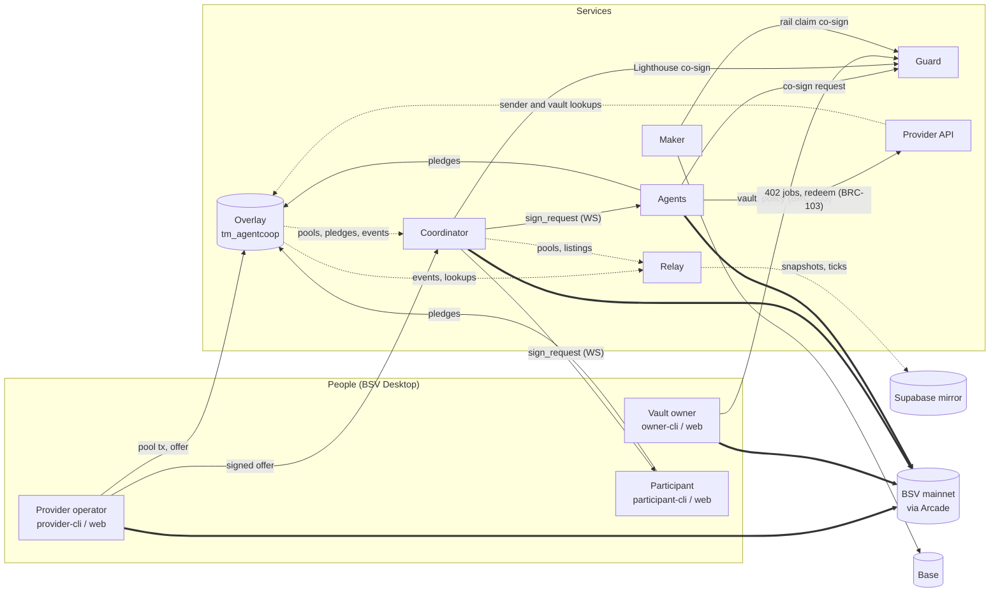

# Architecture

How the AgentCoop components fit together at run time. Each component's own interface (endpoints, messages, configuration) is in its README; this page is about the connections between them. The mechanism itself is explained in [concepts](concepts/pools-and-settlement.md); who has to be trusted for what is in [AUDIT-READINESS.md §2](AUDIT-READINESS.md#2-system-and-trust-boundaries).

## The principle

The chain is the only source of truth for money. A pledge stays a coin in its owner's wallet until the settlement, and the settlement both pays the provider and delivers the credits. Every service that builds or relays a transaction is verified, not trusted: participants and the guard rebuild the settlement from the plan, check every output, and walk the credits' lineage back to the token deploy themselves before they sign. The overlay is for discovery, the coordinator for coordination, and the Supabase mirror for display.

## Components

| Component | Kind | Default port | Role |
|---|---|---|---|
| [`packages/core`](../packages/core/README.md) | library | — | Transaction builders, signers, the settlement verifier, lineage verification, scripts (vault, vault-locked credits, Lighthouse, HTLC). Browser-safe index; Node helpers under `@agentcoop/core/node/*` |
| [`packages/overlay`](../packages/overlay/README.md) | service | 8080 | BSV overlay topic `tm_agentcoop` and lookup service `ls_agentcoop`: admits BSV-21 credits and AgentCoop records (pools, pledges, offers, settlements, vaults), answers queries, streams admissions |
| [`apps/coordinator`](../apps/coordinator/README.md) | service | 8090 | Stores providers' signed offers, runs signing rounds over WebSocket, broadcasts settlements, keeps the listing book, audits settlements from the chain. Holds no keys and no funds |
| [`apps/guard`](../apps/guard/README.md) | service | 8091 | Mandate Vault co-signer: checks every vault spend against the owner's policy before signing; also co-signs Lighthouse pledges and Coop Rail claims |
| [`apps/provider-api`](../apps/provider-api/README.md) | service | 8092 | A simulated provider: paid jobs over HTTP 402 (BRC-105), credit redemption into a capped prepaid balance, credit returns |
| [`apps/agents`](../apps/agents/README.md) | service | 8093 (event feed) | Three autonomous buyers: forecast, decide, pledge, verify and sign, redeem, pay retail, trade on the market |
| [`apps/maker`](../apps/maker/README.md) | service + library | 8094 | Coop Rail counterparty: quotes, funds BSV HTLCs, claims USDC on Base; refund watchdog |
| [`apps/relay`](../apps/relay/README.md) | optional service | — | Mirrors the services' state into Supabase for the web app. Display only |
| [`apps/web`](../apps/web/README.md) | browser app | 5173 (dev) | Consoles for providers, participants, vault owners and observers, plus the pixel-art Town. Signs only through BSV Desktop |
| [`apps/provider-cli`](../apps/provider-cli/README.md), [`apps/participant-cli`](../apps/participant-cli/README.md), [`apps/owner-cli`](../apps/owner-cli/README.md) | CLIs | — | The same flows as the web consoles, from a terminal, signing in BSV Desktop |
| [`contracts/base-htlc`](../contracts/base-htlc/HTLC.sol) | Solidity | — | The Base side of Coop Rail (tested on an in-memory EVM, not deployed) |
| [`infra/`](../infra/README.md) | operations | — | Process runner, Caddy, systemd unit, backups, mainnet preflight |
| `scripts/` | operations | — | Key generation, funding, balances, mainnet validation scripts, mutation testing, `check-docs` |

All ports are defaults; [reference/configuration.md](reference/configuration.md) lists every variable.

## System context

Solid arrows carry requests and signatures; dotted arrows are read-only data and event streams; thick arrows are transactions reaching the chain.



## A pool, from offer to settlement

```mermaid
sequenceDiagram
  autonumber
  participant P as Provider (BSV Desktop)
  participant O as Overlay
  participant C as Coordinator
  participant A as Agent (wallet-toolbox)
  participant G as Guard
  participant B as BSV (Arcade)

  P->>B: T2: reserve N credits + OP_RETURN pool
  P->>O: submit pool tx
  P->>C: POST /offers (SINGLE|ACP signature on the credit input)
  A->>O: lookup pools; decide
  A->>B: T3: pledge coin + registration fee + OP_RETURN pledge
  A->>O: submit pledge
  O-->>C: SSE: admitted
  Note over C: valid pledges reach exactly N
  C->>A: sign_request (plan)
  A->>A: verifySettlementPlan + verifyLineage
  opt the pledge coin sits in a Mandate Vault
    A->>G: POST /cosign (settle)
    G->>G: rebuild from plan, verify, check policy
    G-->>A: guard signature
  end
  A-->>C: sign_response (SIGHASH_ALL on its input)
  C->>B: T5: broadcast settlement
  C->>O: submit settlement
  C-->>A: settled
```

If a participant does not answer within the round timeout (60 s by default), rejects, or signs badly, its pledge outpoint is blacklisted and the coordinator plans the next round from the waiting list, at most three rounds per attempt. If the pool's deadline passes before it fills, nothing is broadcast. Details: [apps/coordinator/README.md](../apps/coordinator/README.md#signing-rounds).

## Where data lives

| Data | Where | Authority |
|---|---|---|
| Pools, pledges, offers, settlements, vault records, listings (optional) | On chain, as `OP_RETURN agentcoop …` records next to the outputs they describe | The chain |
| Credits | BSV-21 outputs on chain | The chain, checked by lineage; the overlay indexes admitted outputs |
| Overlay index | SQLite (`data/overlay/overlay.db`) | Derived; rebuildable from the chain |
| Signed offers, listing book, blacklists, round history | SQLite (`data/coordinator/coordinator.db`) | Coordinator's own; offers are also published on chain |
| Vault policies, decision log, rolling caps | JSON files under `data/guard/` | Guard's own; the chain enforces the 2-of-2 regardless |
| Prepaid credit balances (≤ 20 credits per agent), job records, 402 replay store | Files under `data/provider/` | Provider's own: the one trusted off-chain balance (T-6) |
| Server wallets | SQLite under `data/wallets/`, root keys in `.env` | Each service's own |
| Live mirror for the web | Supabase tables (`live_*`, `coop_events`) | None: display only, rebuilt from the services (T-22) |
| Human wallets | BSV Desktop / BSV Browser | The user |

`data/` and `.env` are git-ignored.

## Mock chain and live runs

| Mode | What runs | Needs |
|---|---|---|
| Tests (`npm test`) and demos (`npm run demo`, `demo:failed-pool`, `demo:injection`) | Overlay, coordinator, guard, provider API and agents in one process on wallet-toolbox's mock chain; every transaction built, signed and checked for real | Node and `npm install` only |
| Web mock (`npm run web:mock`) | The web app with a scripted scenario and a mock BSV Desktop (MSW) | Nothing else |
| Web replay (`?replay=<name>`) | A recorded event stream | Nothing else |
| Live, local (`npm run infra`, then the services you need) | Real services against mainnet | Server wallet keys in `.env`, satoshis, BSV Desktop for human flows ([getting-started.md](getting-started.md#run-the-live-stack-locally), [OPS.md](OPS.md)) |
| Live, public | The same services behind Caddy on one host; the web app on a static host | [infra/README.md](../infra/README.md), [apps/web/README.md](../apps/web/README.md#deploy) |

Which services a live flow needs:

| Flow | Overlay | Coordinator | Guard | Provider API | Agents | Maker |
|---|---|---|---|---|---|---|
| Open a pool, pledge, settle | ✓ | ✓ | | | | |
| Pledge from a Mandate Vault, Lighthouse pledges | ✓ | ✓ | ✓ | | | |
| Redeem credits, 402 jobs | ✓ | | (vault credits) | ✓ | | |
| Market listings and sweeps | ✓ | ✓ | (vault credits) | | | |
| Autonomous agents | ✓ | ✓ | (vault mode) | ✓ | ✓ | |
| Coop Rail quotes | | | | | | ✓ |

## External infrastructure

- **Arcade** (`https://arcade-v2-us-1.bsvblockchain.tech`): broadcasting, transaction status, block headers (`/chaintracks/v2`) for SPV, fee policy.
- **WhatsOnChain**: ancestor fetches as a fallback, the coordinator's pre-round spent check (`SPENT_CHECK=woc`), the owner CLI's vault balance. Data from either source is trusted only after its txid is recomputed from the bytes.
- **BSV Desktop / BSV Browser**: every human signature (`WalletClient('auto')`).
- **Supabase** (optional): the relay's mirror and the web's Realtime transport.
- **Base** (Coop Rail only): an RPC endpoint and the HTLC contract.
- **Anthropic or OpenAI** (optional): the agents' LLM brain; the rules brain needs neither.
